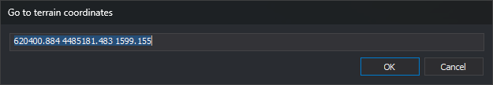

# Moving the photogrammetric window to known coordinates
<!-- id: desplazando-ventana-foto-a-coordenadas -->
<!-- origen: 4a960c31905fa1a35f1e6fbb6137374e367ac91c -->

There are several ways to move the photogrammetric window to a specific location. If you know a point's ground coordinates, you can enter them in **Go to terrain coordinates**.

The dialog has a single field containing the three coordinates separated by spaces, in X, Y, Z order. When opened, the field shows the photogrammetric window's ground coordinates to three decimal places.

1. Open **Photogrammetric window** and select **Go to terrain coordinates...**
2. Check that **Go to terrain coordinates** appears.
3. Replace the field's text with `281854.98 4821292.06 75.36`.
4. Click **OK**.
5. Check that the photogrammetric window moves to the end of a wall.

Follow these steps to move the photogrammetric window 10 meters along **X**:

1. Open **Photogrammetric window** and select **Go to terrain coordinates...**
2. Check that the field shows the current coordinates: `281854.980 4821292.060 75.360`.
3. Change the first value to **281864.98**.
4. Click **OK**.
5. Check that the photogrammetric window has moved 10 meters along X from the end of the wall.

## What the field accepts

* If you enter only X and Y, the window retains the current Z.
* If you enter more than three values, the first three are used.
* If either of the first two values is not a number, or a third value is present and is not a number, clicking **OK** sounds a warning. The dialog remains open and the text is selected for correction.

You can widen **Go to terrain coordinates**. Digi3D.AI saves the dialog's size and position for the next time you open **Go to terrain coordinates**.

## Video

<video controls><source src="https://digi21.blob.core.windows.net/videos-ayuda/Desplazando%20la%20ventana%20fotogrametrica%20a%20unas%20coordenadas%20conocidas.mp4" caption="" type="video/mp4"></video>
