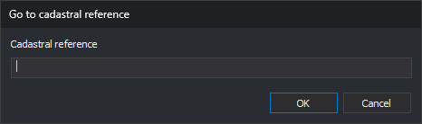

# Moving the photogrammetric window to a cadastral reference
<!-- id: desplazando-ventana-foto-a-referencia-catastral -->
<!-- origen: b262b74681cab0a934b46e404f67f70fa86a5da7 -->

You can move the photogrammetric window to the centroid of a parcel in Spain's Cadastre using its cadastral reference. Digi3D.AI queries the Cadastre web service for the centroid's coordinates, so an Internet connection is required.

1. Open **Photogrammetric window** and select **Go to cadastral reference...**
2. The **Go to cadastral reference** dialog appears.
3. Enter the cadastral reference in **Cadastral reference**.
4. Click **OK**.
5. The photogrammetric window moves to the parcel centroid's X and Y coordinates and retains the current Z.

## Details

* Only the reference's first 14 characters, which identify the parcel, are used. You can enter a property's full 20-character reference.
* The model's coordinate reference system cannot be local. If it is, Digi3D.AI displays a message stating that the active coordinate system must be supported by the Cadastre web services, and the window does not move.
* If the model's horizontal system has an EPSG code, Digi3D.AI requests the centroid in that system. If the Cadastre does not support the code and responds in a different system, Digi3D.AI displays the same message and the window does not move.
* If the horizontal system has no EPSG code, for example because it comes from a .prj file without an authority, the Cadastre returns the centroid in the parcel's ETRS89 UTM zone, and Digi3D.AI uses those coordinates without transforming them.
* If the Cadastre returns an error, for example because the reference does not exist, Digi3D.AI displays the error text and the window does not move.
* The connection uses the [Internet communication](/digi3d-ai/referencia/cuadros-de-dialogo/configuracion/comunicacion-con-internet/README.md) settings in **Configuration**: a direct connection or the Windows proxy settings.
