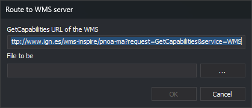
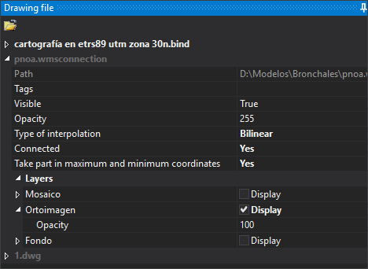
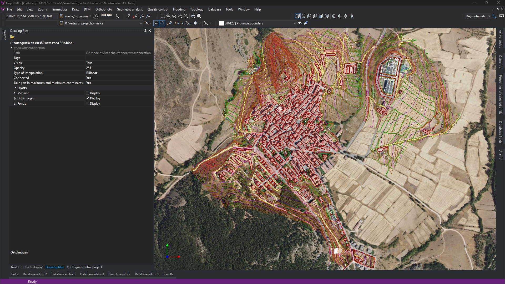

# Connecting to a WMS server
<!-- id: conectar-servidor-wms -->
<!-- origen: d7b19b0b2a6f5b5ffd71891797f48a069a5b1189 -->

Digi3D.AI displays WMS (*Web Map Service*) layers, such as PNOA orthophotos, beneath drawing cartography. Saves connections in `.wmsconnection`, loaded as a reference file. Each zoom change requests active layer images for the visible area.

This video shows the full procedure:

<video controls><source src="https://digi21.blob.core.windows.net/videos-ayuda/CargarCapaWMS.mp4" type="video/mp4"></video>

## Requirements

- Server **GetCapabilities** URL, for example IGN's PNOA:

  ```
  http://www.ign.es/wms-inspire/pnoa-ma?request=GetCapabilities&service=WMS
  ```

- A drawing window with an EPSG horizontal CRS supported by at least one server layer. See [CRS location in drawing files](/digi3d-ai/sistemas-referencia-coordenadas/implementacion-src-modulos-digi3d/archivos-de-dibujo/ubicacion-src-archivos-dibujo.md).

## 1. Creating the connection file

1. Open the target drawing window. If open, receives the connection automatically in step 5.
2. Select **File/Create a WMS server connection...** to open **Route to WMS server**:

   

3. Enter the URL in **GetCapabilities URL of the WMS server**. Defaults to IGN's PNOA.
4. Click **...** to select the folder and `.wmsconnection` name, or enter **File to be created**. **OK** remains disabled without a path.
5. Click **OK** to connect and read capabilities:
   - Connection failure creates no file.
   - File creation failure, such as no write permission, displays **Unable to create the file** with its path.
   - Success creates the file. An open drawing window loads it as a reference and shows **Drawing file**.

## 2. Loading the connection in the drawing window

Required only if no drawing was open during creation, or to reuse the connection in another drawing window.

1. Run [LOAD\_F](/digi3d-ai/referencia/ventana-de-dibujo/ordenes/c/carga-f.md) or select **File/Load reference file...**.
2. Select `.wmsconnection`.

No layer available in the drawing CRS produces **Incompatible reference coordinate systems**, showing the drawing CRS and server-supported CRSs. A non-EPSG drawing CRS produces **The horizontal coordinate system of the drawing file is not compatible with the EPSG authority.**

## 3. Selecting layers and configuring the connection

Expand the connection in **Drawing file** (**Window/Drawing file**) to see properties:



Initially no layers are active. Expand **Layers** and enable **Display** on desired layers.

| Property | Description |
| :--- | :--- |
| Path | `.wmsconnection` path. |
| Tags | Drawing file tags. |
| Visible | Shows or hides every connection layer. |
| Opacity | File opacity, 0 (transparent) to 255 (opaque). |
| Type of interpolation | **Bilinear** or **Closest neighbor**. Bilinear produces clearer zoomed images at greater computational cost. |
| Connected | **Yes** requests images on every zoom change. |
| Take part in maximum and minimum coordinates | **Yes** includes layer extents when calculating zoom extents. |
| Layers | One entry per layer, using its title. **Display** toggles it; **Opacity** sets 0–100 (default 100). Sublayers appear under their own **Layers** category. |

## 4. Result

With **Display** enabled, server imagery appears beneath cartography:



While **Connected** is **Yes**, each zoom change requests active layer images for the visible area.

## See also

- [WMS (Web Map Service)](/digi3d-ai/referencia/ventana-de-dibujo/importadores-y-exportadores/wms.md): `.wmsconnection` format.
- [LOAD\_F](/digi3d-ai/referencia/ventana-de-dibujo/ordenes/c/carga-f.md): load a reference file.
- [Importers and exporters](/digi3d-ai/referencia/ventana-de-dibujo/importadores-y-exportadores/README.md): supported formats.
