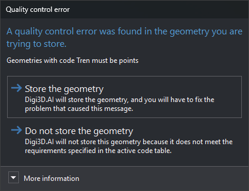
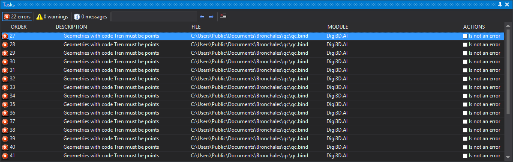

# Quality control scripts
<!-- id: guiones-de-control-de-calidad -->
<!-- origen: 8a4f032ef8460700fc890e5655e8586d85d2c229 -->

Digi3D.AI quality controls are Python functions stored under [Python environment](/digi3d-ai/referencia/editor-de-tablas-de-codigos/pestanas/entorno-python.md) in the codes table. Each code assigns its functions in **Quality controls to apply** ([Code properties](/digi3d-ai/referencia/editor-de-tablas-de-codigos/pestanas/codigos/propiedades-del-codigo.md)).

No .NET assembly is compiled: Digi3D.AI's Python interpreter executes Python environment contents whenever the codes table loads or changes, and calls functions assigned to each code.

See [Python quality controls](/digi3d-ai/programacion/python/controles-de-calidad/README.md) for the language reference. [Guiones-Control-Calidad-Python-Digi3D](https://github.com/digi21/Guiones-Control-Calidad-Python-Digi3D) provides 64 ready-to-use controls described in [Python quality control repository](/digi3d-ai/programacion/python/guiones-control-calidad/README.md).

## When they run

* **During digitizing.** With [QUALITY_CONTROL_ON_ENTITY_END](/digi3d-ai/referencia/ventana-de-dibujo/variables/c/control-calidad.md) enabled (**Quality control/Analyze quality control when an entity is finished**) and **Analyze quality control when digitizing** set to **Yes**, runs the code's controls before saving the geometry. Each function receives `adding_geometry=True`.
* **On demand.** [QUALITY_CONTROL_COD](/digi3d-ai/referencia/ventana-de-dibujo/ordenes/c/control-calidad-cod.md), [QUALITY_CONTROL_VISIBLE_ENTITIES](/digi3d-ai/referencia/ventana-de-dibujo/ordenes/c/control-calidad-entidades-visibles.md), [QUALITY_CONTROL_SELECTION](/digi3d-ai/referencia/ventana-de-dibujo/ordenes/c/control-calidad-seleccion.md) and **Quality control** menu options run each analyzed geometry code's controls regardless of **Analyze quality control when digitizing**. Each function receives `adding_geometry=False`.

A multicoded geometry is analyzed once per code, passing its index as `code_index`.

## How Digi3D.AI reports errors

During digitizing:

* A geometry error (`GeometryError` or `GeometryRelationError`) opens **Quality control error** with the error message and **Store the geometry** / **Do not store the geometry**. If coordinates are supplied, **Store the geometry** moves the view there. **Do not store the geometry** discards it and displays the message in a balloon.

    

* A warning (`GeometryWarning`) appears in a balloon and the geometry is saved.
* A database field error (`DatabaseFieldError`) opens a dialog to correct the field value. Cancelling prevents storage. Correcting the value reruns that code's controls; geometry errors and warnings with messages already shown are not displayed again.

On demand, each error and warning becomes a [task pane](/digi3d-ai/referencia/paneles/tareas.md) entry. Double-click to move to the error coordinates or geometry.

## Pages in this section

* [Creating a quality control script](creacion-de-un-guion-de-control-de-calidad/README.md): declaring a function and assigning it to a code.
* [Error types](creacion-de-un-guion-de-control-de-calidad/tipos-de-errores/README.md): return values and their effects.
* [Quality control examples](../ejemplos/README.md).
