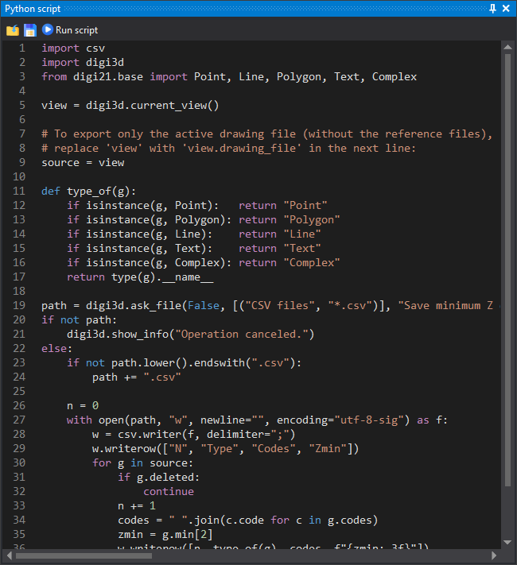

# Python pane
<!-- id: panel-de-python -->
<!-- origen: e94c22eac2b3548552f74f4032b544f8fa8c003c -->

Digi3D.AI includes an **embedded Python interpreter** that runs scripts **inside the application**, accessing the **active drawing window**, commands, panes and other program services.

Scripts have access to **`digi3d`**, available only inside Digi3D.AI (it cannot be imported from a [console application](../aplicaciones-de-consola/README.md)).

```python
import digi3d

view = digi3d.current_view()
for geometry in view:
    print(type(geometry).__name__)
```

## Ways to run a script



[Python script](../../../referencia/paneles/guion-python.md) contains the script editor and output.

Run a script from the **Python script pane**, **as a command** (by name from the command console), or as a **quality control**. See [Running scripts](ejecutar-guiones.md).

## The `digi3d` object

The usual entry point is [`current_view()`](../referencia/digi3d/functions.md#current_view), returning the active [DrawingView](../referencia/digi3d/drawing-view.md). `digi3d` also **reexports** [digi21.base](../referencia/digi21.base/README.md) core types, usable without further imports (`FeatureCode`, `Geometry`, `Point`, `Line`, `Polygon`…).

See the full description in [Reference: `digi3d` module](../referencia/digi3d/README.md).

```python
import digi3d

# Create a line and add it to the active drawing window
linea = digi3d.Line(["CARR"], [(0, 0, 0), (10, 0, 0), (10, 10, 0)])
digi3d.current_view().add(linea)
```

## Links

- [Running scripts](ejecutar-guiones.md): pane, command console and quality controls.
- [Programming examples](ejemplos/README.md): ready-to-use scripts and commands.
- [Reference: `digi3d` module](../referencia/digi3d/README.md): DrawingView, commands, tasks, functions…
- [Reference: digi21.base](../referencia/digi21.base/README.md): core types reexported by `digi3d`.
