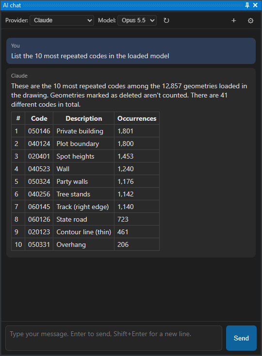

# AI assistant
<!-- id: asistente-ia -->
<!-- origen: fda4174df16835c8854b2e11c815b9167e30f09e -->

The **AI chat pane** lets you ask an artificial intelligence assistant, **in natural language**, to query and modify the active drawing. Type what you need—for example, *“zoom to the first building,”* *“how many contours are there?”* or *“delete texts with code 050146”*—and the assistant performs the requested operations in the drawing window.

No programming knowledge is required: the assistant translates your request into drawing operations.

The assistant supports several **AI providers**:

- **Cloud services**: Claude (Anthropic), OpenAI, Azure OpenAI, Kimi (Moonshot AI) and OpenRouter.
- **Local servers**, which run the model on your computer or a server on your network without sending data over the internet: LM Studio, Ollama or any server compatible with the OpenAI API.

## Opening the pane

Select **Window → AI chat**. The pane is dockable, like other Digi3D.AI panes.

## Configuring the provider

Select and configure a provider the first time you open the pane:

1. Select a provider in the **Provider** drop-down list in the pane header.
2. Click **⚙** in the header. Opens [Configuration](../cuadros-de-dialogo/configuracion/README.md) with [**AI assistant**](../cuadros-de-dialogo/configuracion/asistente-de-ia/README.md) selected.
3. Expand the provider item and enter the [**API key**](../cuadros-de-dialogo/configuracion/asistente-de-ia/clave-de-api-del-proveedor-de-ia.md) supplied by your provider. Local servers do not require a key.
4. Check the [**URL**](../cuadros-de-dialogo/configuracion/asistente-de-ia/url-del-proveedor-de-ia.md). If empty, Digi3D.AI uses the provider's standard address. Azure OpenAI and OpenAI-compatible have no standard address: enter their URL. Also change it for a local server on another computer.
5. Click **Accept**.
6. Select a model in **Model**. Without a selected model, the assistant does not send the request and displays a notice in the conversation.

Digi3D.AI saves each provider's configuration separately, so switching providers does not require reentering keys. The URL and model are saved per _Windows_ user. The API key is encrypted using _Windows_ data protection (DPAPI) at machine level: all users on the computer share it, and it does not work if copied to another computer.

Accepting Configuration with a new URL or API key for the active provider makes the assistant forget the current conversation, although messages remain on screen.

**AI assistant** also contains these pane options: [Show run_python code](../cuadros-de-dialogo/configuracion/asistente-de-ia/mostrar-codigo-run-python.md), [Show token counter](../cuadros-de-dialogo/configuracion/asistente-de-ia/mostrar-contador-de-tokens.md), [Confirm dangerous operations](../cuadros-de-dialogo/configuracion/asistente-de-ia/confirmar-operaciones-peligrosas.md) and [Create chat panel at startup](../cuadros-de-dialogo/configuracion/asistente-de-ia/crear-panel-de-chat-al-iniciar.md).

Provider instructions:

- [Cloud providers](proveedores.md): where to obtain each service's API key and what to enter in each field.
- [Configuring LM Studio](lm-studio.md): step-by-step tutorial for running the model on your computer with LM Studio.
- [Configuring Ollama](ollama.md): step-by-step tutorial for running the model on your computer or a network server with Ollama.

## Choosing a model

**Model** shows:

- The provider's recommended models, if any.
- Models returned by the provider's server. Digi3D.AI requests this list at startup, when switching to a provider whose list has not yet been requested, and when accepting Configuration with a new URL or API key. It does not request it if the URL is missing or a provider that requires an API key has none. Azure OpenAI does not provide this list. Click **↻** to request it again.
- **Other...**, to enter a model identifier absent from the list manually.

Digi3D.AI remembers the model selected for each provider.

## Attaching files

Attach files to a message so that the model analyzes images, PDF documents or text files:

1. Click the paperclip button (📎, **Attach files**), to the left of the text box. The file selection dialog opens.
2. Select one or more files and click **Open**. Each file appears as a label above the text box, with its name and, for an image, a thumbnail.
3. Click **×** on a file's label to remove the file before sending the message.
4. Type the message and click **Send**. You can also send the files without typing any text.

In the conversation, your message shows the name of each attached file and the thumbnail of each image.

If Digi3D.AI cannot obtain the path of one of the files, the conversation shows the notice "The file path of one or more attachments could not be obtained." If the message has text, Digi3D.AI sends the message text with the paths it obtained. If the message has no text and Digi3D.AI obtained no path, nothing is sent to the model and nothing is added to the assistant's conversation: attach the files again.

For each file, the model receives a line with the file's **full path**. With that path, the assistant can open the file with the Digi3D.AI libraries, for example a drawing file with `digi21.io`. In addition to the path, the model receives the file's content according to its type:

| File type | Content the model receives in addition to the path |
| --- | --- |
| PNG, JPEG, GIF or WebP image | The image. |
| PDF | The document. |
| UTF-8 text file with a text extension: `.txt`, `.csv`, `.tsv`, `.json`, `.geojson`, `.xml`, `.gml`, `.kml`, `.md`, `.py`, `.log`, `.ini`, `.cfg`, `.conf`, `.yaml`, `.yml`, `.toml`, `.html`, `.htm`, `.sql`, `.prj`, `.wkt`, `.js`, `.cs`, `.c`, `.cpp`, `.h`, `.hpp`, `.bat`, `.cmd`, `.ps1` or `.sh` | The text of the file, preceded by its name, if the file is 100,000 bytes or smaller. |
| Any other file | Nothing. |

Digi3D.AI recognizes images and PDF files by their content, not by their extension. For a text file that is not UTF-8 encoded, the model receives only the path.

### Limits

If an image, a PDF or a text file exceeds the limit for its type, the model receives only the file path and the conversation shows a notice. Digi3D.AI sets the limit for text files. The limits for images and PDF files are those that Anthropic publishes for Claude and those that OpenAI publishes for the other providers, which use the OpenAI API format. OpenAI does not publish a maximum size per image, so Digi3D.AI applies the PDF limit to images:

| Provider | Images | PDF |
| --- | --- | --- |
| Claude | At most 7,500,000 bytes (10,000,000 bytes base64-encoded) and 8000 pixels wide and high. | At most 96,000,000 bytes (128,000,000 bytes base64-encoded, the maximum request size). |
| OpenAI, Azure OpenAI, Kimi, OpenRouter, LM Studio, Ollama and OpenAI-compatible | Less than 50,000,000 bytes. | Less than 50,000,000 bytes. |

The provider also limits the complete request, which includes every file in the conversation:

- Claude accepts at most 128 MB per request and 100 PDF pages (600 for models with a one-million-token context). In a request with more than 20 images, each image must be at most 3000 pixels wide and high.
- OpenAI accepts at most 50 MB across all the files in a request.

If the request exceeds a provider limit, or the model does not accept images or PDF files, the conversation shows the provider's error. The file types a model accepts depend on the model and the provider. The assistant keeps messages with images or PDF files in the conversation even if the request fails. When a request fails and the conversation contains images or PDF files, Digi3D.AI shows, after the error, the notice "The conversation contains images or PDF files. Images and PDF files remain in the conversation history and are sent again with subsequent requests. If a request failed because of those attachments or the provider's request size limit, click "New conversation" to start a new conversation without those attachments." Click **＋** (**New conversation**) in the header and send the message with another model or without the files the provider rejects.

Attached files are part of the conversation: Digi3D.AI sends them again in each request to the provider until you start a new conversation. The provider counts the tokens of the attached content it receives in each request and bills those tokens if the provider charges for usage.

## Example requests

These examples progress from easier to harder. Use them to test a new provider or model. Replace example codes (`020400`, `050146`…) with codes present in your drawing.

**Queries.** The assistant queries the drawing without modifying it.

- *“How many geometries are loaded?”*
- *“How many geometries have each code? Give me the ten most frequent.”*
- *“What are the maximum and minimum elevations in the entire drawing?”*

**Concept searches.** The assistant looks for the concept's codes in the codes table and, if absent, in drawing texts.

- *“How many buildings are there?”*
- *“How many index contours are there?”* The assistant distinguishes index contours from intermediate contours by code and elevation relative to the contour interval.
- *“Take me to Plaza Mayor.”* Replace “Plaza Mayor” with a place name labeled in your drawing. The assistant searches for the text and zooms to it.

**Calculations.** Check results with Digi3D.AI measurement commands.

- *“What is the total area of polygons with code 020400?”*
- *“Which point with code X is closest to the point with code Y?”*

**Navigation.**

- *“Zoom to the first building.”*

**Modifications.** The assistant reports how many geometries it changed. Undo the change with UNDO.

- *“Replace code 020400 with 020401 in every geometry that has it.”*
- *“Delete all geometries with code 020401.”* Opens **Security confirmation** (see *Operations requiring confirmation*).

**Conversation with context.** The assistant remembers the subject.

- *“How many lines have code 020400?”* followed by *“And which is the longest?”*

**Environment limits.** The assistant has no operating system access.

- *“What environment variables does the system have?”* The assistant explains that it cannot query them.

**Reusable programs.** If you request a command, interactive command or quality control, the assistant writes Python code and shows it for you to install.

- *“Write a quality control that checks contours for repeated vertices.”*

The assistant knows the **project's codes table**. It therefore understands concepts such as “building,” “contour” and “parcel” without requiring their codes. If a name matches no code, it also searches drawing texts (for example, a labeled place name).

The assistant responds in the language you use.

## Operations requiring confirmation

Before an irreversible or extensive operation, Digi3D.AI opens **Security confirmation** with a summary of the assistant's intended action. Confirmation is required for:

- Deleting or overwriting files on disk.
- Running system commands.
- Deleting drawing geometries.
- Accessing the network or web services.

Click **Allow** to perform the operation or **Cancel** to prevent it. Cancelling leaves it unexecuted and tells the assistant not to repeat it. Selecting **Allow the remaining operations in this conversation** suppresses further questions until you start a new conversation.

## Stopping the assistant

- While the assistant waits for the provider's response, click **Stop**.
- While it performs a drawing operation, Digi3D.AI does not respond to the interface and **Stop** does not work: press **Esc** with Digi3D.AI in the foreground. The operation stops when it next executes Python code, and the assistant reports cancellation. If it is inside a lengthy Digi3D.AI function, it stops when that function returns.
- An operation lasting more than **5 minutes** stops automatically. Change the limit in [Advanced settings](#advanced-settings).

## Undo

Undo the assistant's drawing changes with **UNDO**, like any other change. Each assistant operation is one UNDO step; one request may generate several operations.

## Conversation and history

- The assistant remembers the conversation: ask *“and which is the longest?”* after asking about lines with a particular code.
- Click **＋** in the header to start a new conversation. The assistant forgets the previous one. Switching providers also starts a new conversation.
- With the cursor on the first line of the text box, press **Up Arrow** to recall earlier messages and **Down Arrow** to return to more recent ones. Digi3D.AI saves the last 100 messages between sessions.

## Things to consider

- **AI can make mistakes.** Review results, especially after important operations.
- **Privacy.** With a cloud provider, conversation text, the content of attached files and drawing data queried by the assistant (codes, coordinates, texts) are sent to that provider. With LM Studio or Ollama, all data stays on your computer or network.
- **Cost.** Cloud providers charge the API key holder for usage. Local servers have no usage charges but require a computer with a suitable graphics card.
- **Connection.** Cloud providers require internet access. If the provider is overloaded or the account exceeds its usage limit, Digi3D.AI retries up to 3 times before showing the error.
- **Restricted Python environment.** The assistant can use only Digi3D.AI libraries and part of the Python standard library, without operating system modules such as `os` or `subprocess`. Additional packages cannot be installed.

## Advanced settings

Change the operation duration limit in the Windows registry under `HKEY_CURRENT_USER\Software\Digi21\Digi3D.NET\App\Configuration`. Digi3D.AI reads this DWORD value for each assistant operation.

| Value | Default | Effect |
| --- | --- | --- |
| `ClaudeChatLimiteSegundos` | 300 | Maximum operation duration in seconds before automatic cancellation. 0 removes the limit. |

Change the pane's other options in Configuration under [AI assistant](../cuadros-de-dialogo/configuracion/asistente-de-ia/README.md):

| Option | Registry value | Default |
| --- | --- | --- |
| [Confirm dangerous operations](../cuadros-de-dialogo/configuracion/asistente-de-ia/confirmar-operaciones-peligrosas.md) | `ClaudeChatConfirmaciones` | Yes |
| [Show token counter](../cuadros-de-dialogo/configuracion/asistente-de-ia/mostrar-contador-de-tokens.md) | `ClaudeChatTokens` | No |
| [Show run_python code](../cuadros-de-dialogo/configuracion/asistente-de-ia/mostrar-codigo-run-python.md) | `ClaudeChatDebug` | No |
| [Create chat panel at startup](../cuadros-de-dialogo/configuracion/asistente-de-ia/crear-panel-de-chat-al-iniciar.md) | `CrearPanelChat` | Yes |

An administrator can replace the assistant's instructions by creating `%PROGRAMDATA%\Digi3D.NET\ChatSystemPromptParteA.txt`. If present and nonempty, Digi3D.AI uses its contents instead of the built-in instructions. The Digi3D.AI API reference is always added.

## Requirements

- **WebView2** (Microsoft Edge), included with Windows 10 and 11.
- A cloud provider's **API key**, or a local LM Studio or Ollama server.

## See also

- [MCP server](servidor-mcp.md): lets Claude Code, Claude Desktop or another MCP client work in Digi3D.AI with the same capabilities as this pane.
- [Python programming](../../programacion/python/README.md): automate tasks with your own scripts. The assistant uses this same API.
