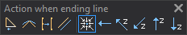

# Action on finishing a line
<!-- id: accion-al-finalizar-la-linea -->
<!-- origen: f59061d56359cb9be5818f3a387319af28e68a92 -->

Configures actions performed when finishing a line.

## Buttons

* Toggle [C](/digi3d-ai/referencia/ventana-de-dibujo/variables/c/c.md).
* Toggle [S](/digi3d-ai/referencia/ventana-de-dibujo/variables/s/s.md).
* Toggle [G](/digi3d-ai/referencia/ventana-de-dibujo/variables/g/g.md).
* Toggle [P](/digi3d-ai/referencia/ventana-de-dibujo/variables/p/p.md).
* Set [GOTO_START](../ventana-de-dibujo/variables/i/ir-principio.md) to no movement.
* Set _GOTO_START_ to return to the line origin.
* Return to the origin and increase Z by a multiple of the contour interval.
* Return to the origin and decrease Z by a multiple of the contour interval.
* Keep X, Y and increase Z by a multiple of the contour interval.
* Keep X, Y and decrease Z by a multiple of the contour interval.
