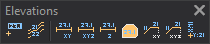

# Elevations
<!-- id: acotaciones -->
<!-- origen: 0bce73c50c6088d2b5c2c70803e506a1d047eea8 -->

Runs commands related to dimensioning.

## Buttons

* Button that runs the command [HEIGHT](/digi3d-ai/referencia/ventana-de-dibujo/ordenes/c/cota.md).
* Button that runs the command [TAG_CONTOURS](../ventana-de-dibujo/ordenes/r/rotula-curvas.md).
* Button that runs the command [DRAW_DISTANCE](../ventana-de-dibujo/ordenes/d/dibuja_distancia.md).
* Button that runs the command [DRAW\_DISTANCE\_3D](../ventana-de-dibujo/ordenes/d/dibuja_distancia_3d.md).
* Button that runs the command [DRAW_HEIGHT](../ventana-de-dibujo/ordenes/d/dibuja_altura.md).
* Button that runs the command [AREA](/digi3d-ai/referencia/ventana-de-dibujo/ordenes/a/area.md).
* Button that runs the command [DRAW_PERIMETER](../ventana-de-dibujo/ordenes/d/dibuja_perimetro.md).
* Button that runs the command [DRAW\_PERIMETER\_3D](../ventana-de-dibujo/ordenes/d/dibuja_perimetro_3d.md).
* Button that runs the command [PUT_XY](../ventana-de-dibujo/ordenes/p/poner-xy.md).
