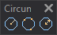

# Circumferences
<!-- id: circunferencias -->
<!-- origen: 4836b14a58c86c6a50001f117dae61e4c19deda5 -->

Runs commands related to circles.

## Buttons

* Button that runs the command [CIR2P](/digi3d-ai/referencia/ventana-de-dibujo/ordenes/c/cir2p.md).
* Button that runs the command [CIR3P](/digi3d-ai/referencia/ventana-de-dibujo/ordenes/c/cir3p.md).
* Button that runs the command [CIRCR](/digi3d-ai/referencia/ventana-de-dibujo/ordenes/c/circr.md).
