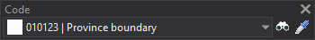

# Code
<!-- id: codigo -->
<!-- origen: c56c075b72d6d03927e8414cb0631245d67cc718 -->

Runs commands related to codes.

The Code toolbar is only enabled if you select **Single-coding toolbar** in the [Code selection interface](../cuadros-de-dialogo/configuracion/diging/interfaz-para-seleccionar-codigo.md) field in the program configuration.

## Buttons

* Drop-down list for selecting the active code.
* Button that runs the command [COD](/digi3d-ai/referencia/ventana-de-dibujo/ordenes/c/cod.md).
* Button that runs the command [CLONAR\_CÓDIGOS](/digi3d-ai/referencia/ventana-de-dibujo/ordenes/c/clonar-codigos.md).
