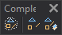

# Complexes
<!-- id: complejos -->
<!-- origen: 9545ac654d22174b0c233394be6389966398a38f -->

Runs commands related to complex entities.

## Buttons

* Button that runs the command [CREATE_COMPLEX](../ventana-de-dibujo/ordenes/c/crear-complejo.md).
* Button that runs the command [EXPLOIT_COMPLEX](../ventana-de-dibujo/ordenes/e/explotar-complejo.md).
* Button that runs the command [EXPLOIT_COMPLEXES_COD](../ventana-de-dibujo/ordenes/e/explotar-complejos-cod.md).
