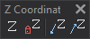

# Z Coordinate
<!-- id: coordenada-z -->
<!-- origen: 76b7592008caf825d653d214bdbce5d92852b7e6 -->

Runs commands related to the Z coordinate.

## Buttons

* Button that runs the command [Z](/digi3d-ai/referencia/ventana-de-dibujo/variables/z/z.md).
* Button that changes the value of the variable [FIXZ](/digi3d-ai/referencia/ventana-de-dibujo/variables/f/fijaz.md).
* Button that runs the command [MOVE DOWN_Z](../ventana-de-dibujo/ordenes/b/baja-z.md).
* Button that runs the command [MOVESUP_Z](../ventana-de-dibujo/ordenes/s/sube-z.md).
