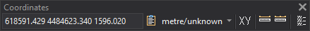

# Coordinates
<!-- id: coordenadas -->
<!-- origen: 9e0fc1d071313ac512509eff275b7248d29547fd -->

Performs tasks involving X and Y coordinates.

## Buttons

* Coordinate display for the drawing window input device. Also accepts coordinate entry.
* **Copy coordinates to the clipboard**: copies the current display as text in the same format: space-separated X, Y and Z with the drawing window's decimal places. To copy a specific point, use [COPY\_COORDINATES](/digi3d-ai/referencia/ventana-de-dibujo/ordenes/c/copiar-coordenadas.md).
* Units button: drawing window X and Y units, followed by Z units. Clicking shows its horizontal reference system. The arrow offers **Show horizontal reference coordinate system...** and **Show vertical reference coordinate system...**, opening [Coordinate reference system parameters](../cuadros-de-dialogo/parametros-del-sistema-de-referencia-de-coordenadas.md).
* Run [XY](/digi3d-ai/referencia/ventana-de-dibujo/ordenes/x/xy.md).
* Run [MEASURE](/digi3d-ai/referencia/ventana-de-dibujo/ordenes/m/mide.md).
* Run [MEASURE+](../ventana-de-dibujo/ordenes/m/mide-mas.md).
* Run [ADD](/digi3d-ai/referencia/ventana-de-dibujo/ordenes/a/agrega.md).
