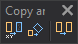

# Copy and duplicate
<!-- id: copiar-y-duplicar -->
<!-- origen: db68e4847d779bcc8576ff30a9ff4fe99d5cec03 -->

Runs commands related to copying and duplicating geometries.

## Buttons

* Button that runs the command [COPY](/digi3d-ai/referencia/ventana-de-dibujo/ordenes/c/copiar.md).
* Button that runs the command [COPYP](/digi3d-ai/referencia/ventana-de-dibujo/ordenes/c/copia-2p.md).
* Button that runs the command [DUP](/digi3d-ai/referencia/ventana-de-dibujo/ordenes/d/dup.md).
