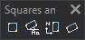

# Squares and rectangles
<!-- id: cuadrados-y-rectangulos -->
<!-- origen: 5679b9d177ca76da8683c4dff3e2ac31c711a88e -->

Runs commands related to squares and rectangles.

## Buttons

* Button that runs the command [2P](/digi3d-ai/referencia/ventana-de-dibujo/ordenes/2/2p.md).
* Button that runs the command [2P\_AA](/digi3d-ai/referencia/ventana-de-dibujo/ordenes/2/2p-aa.md).
* Button that runs the command [RECTANGLE\_2P\_NORTH](/digi3d-ai/referencia/ventana-de-dibujo/ordenes/r/rectangulo-2p-norte.md).
* Button that runs the command [3P](/digi3d-ai/referencia/ventana-de-dibujo/ordenes/3/3p.md).
