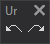

# Undo
<!-- id: deshacer -->
<!-- origen: facc73bdd8fb2db2992792317b2a81b65069c75b -->

Runs commands related to undoing the last operation.

## Buttons

* Button that runs the command [UNDO](/digi3d-ai/referencia/ventana-de-dibujo/ordenes/u/undo.md).
* Button that runs the command [REDO](/digi3d-ai/referencia/ventana-de-dibujo/ordenes/r/redo.md).
