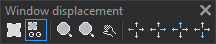

# Window displacement
<!-- id: desplazamientos-de-ventana -->
<!-- origen: 6cab44451b36965b004ac0cebc196931905cb4d4 -->

Runs commands related to moving the drawing window view.

## Buttons

* Button that toggles the variable [AUTO_MOUSE](../ventana-de-dibujo/variables/a/auto-raton.md).
* Button that toggles the variable [AUTO](/digi3d-ai/referencia/ventana-de-dibujo/variables/a/auto.md).
* Button that runs the command [ZOOMTO](/digi3d-ai/referencia/ventana-de-dibujo/ordenes/z/zooma.md).
* Button that runs the command [ZOOMP](/digi3d-ai/referencia/ventana-de-dibujo/ordenes/z/zoomp.md).
* Button that runs the command [2PZOOM](/digi3d-ai/referencia/ventana-de-dibujo/ordenes/z/zoom2p.md).
* Button that runs the command [LFTZOOM](/digi3d-ai/referencia/ventana-de-dibujo/ordenes/z/zoomizq.md).
* Button that runs the command [RGHZOOM](/digi3d-ai/referencia/ventana-de-dibujo/ordenes/z/zoomder.md).
* Button that runs the command [ZOOMUP](/digi3d-ai/referencia/ventana-de-dibujo/ordenes/z/zoomsup.md).
* Button that runs the command [LOWERZOOM](/digi3d-ai/referencia/ventana-de-dibujo/ordenes/z/zoominf.md).
