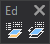

# Edit codes
<!-- id: editar-codigos -->
<!-- origen: 7cb00b51f758c0467493db25571c40a45eb5a932 -->

Runs commands related to editing codes of existing geometries.

## Buttons

* Button that runs the command [EDIT\_CODES](/digi3d-ai/referencia/ventana-de-dibujo/ordenes/e/editar-cod.md).
* Button that runs the command [CHNG\_COD](/digi3d-ai/referencia/ventana-de-dibujo/ordenes/c/camb-cod.md).
