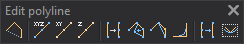

# Edit polyline
<!-- id: editar-polilinea -->
<!-- origen: ee2369bdcdaea3a87a1d6288201a85450eb4de15 -->

Runs commands related to editing polylines.

## Buttons

* Button that runs the command [CLOSE](/digi3d-ai/referencia/ventana-de-dibujo/ordenes/c/cierra.md).
* Button that runs the command [EDIT_XYZ](../ventana-de-dibujo/ordenes/e/editar-xyz.md).
* Button that runs the command [EDIT](/digi3d-ai/referencia/ventana-de-dibujo/ordenes/e/editar.md).
* Button that runs the command [EDIT_Z](../ventana-de-dibujo/ordenes/e/editar-z.md).
* Button that runs the command [INSERT_VERTEX](../ventana-de-dibujo/ordenes/i/inserta-vertice.md).
* Button that runs the command [MODIFYVERTEX](../ventana-de-dibujo/ordenes/m/modifica-vertice.md).
* Button that runs the command [DELETE_VERTEX](../ventana-de-dibujo/ordenes/b/borra-vertice.md).
* Button that runs the command [FILLET](/digi3d-ai/referencia/ventana-de-dibujo/ordenes/a/acuerdo.md).
* Button that runs the command [GEN](/digi3d-ai/referencia/ventana-de-dibujo/ordenes/g/gen.md).
* Button that runs the command [SMOOTH](/digi3d-ai/referencia/ventana-de-dibujo/ordenes/s/suaviza.md).
