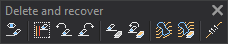

# Delete and recover
<!-- id: eliminar-y-recuperar -->
<!-- origen: f7a8ddac0228b7fab7e0eae3ebf87ac3789c36a6 -->

Runs commands related to deleting and recovering geometries.

## Buttons

* Button that toggles the variable [DELETED](/digi3d-ai/referencia/ventana-de-dibujo/variables/b/borrados.md).
* Button that runs the command [DELETE_E](../ventana-de-dibujo/ordenes/b/borra-e.md).
* Button that runs the command [DELETE_LAST](../ventana-de-dibujo/ordenes/b/borra-ultimo.md).
* Button that runs the command [RECOVER](/digi3d-ai/referencia/ventana-de-dibujo/ordenes/r/recupera.md).
* Button that runs the command [DELETE_COD](../ventana-de-dibujo/ordenes/b/borra-cod.md).
* Button that runs the command [RECOVER_COD](../ventana-de-dibujo/ordenes/r/recupera-cod.md).
* Button that runs the command [DELETE_W](../ventana-de-dibujo/ordenes/b/borra-v.md).
* Button that runs the command [DELETE_COD_W](../ventana-de-dibujo/ordenes/b/borra-cod-v.md).
* Button that runs the command [CLEAN](/digi3d-ai/referencia/ventana-de-dibujo/ordenes/l/limpia.md).
