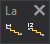

# Ladders
<!-- id: escaleras -->
<!-- origen: 0df7879245022a2e35113afca91511ec07efe91a -->

Runs commands related to drawing stairs.

## Buttons

* Button that runs the command [LADDER](/digi3d-ai/referencia/ventana-de-dibujo/ordenes/e/escalera.md).
* Button that runs the command [LADDER_AD](../ventana-de-dibujo/ordenes/e/escalera-da.md).
