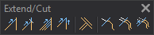

# Extend/Cut
<!-- id: extender-recortar -->
<!-- origen: 443e19285df994a32b566376f1133846f49df2ca -->

Runs commands related to extending and trimming existing geometries.

## Buttons

* Button that runs the command [SPR](/digi3d-ai/referencia/ventana-de-dibujo/ordenes/e/ext.md).
* Button that runs the command [SPR_D](../ventana-de-dibujo/ordenes/e/ext-p.md).
* Button that runs the command [SPR_M](../ventana-de-dibujo/ordenes/e/ext-m.md).
* Button that runs the command [SPR2X](/digi3d-ai/referencia/ventana-de-dibujo/ordenes/e/ext2x.md).
* Button that runs the command [INTERSECTION](/digi3d-ai/referencia/ventana-de-dibujo/ordenes/c/cruce.md).
* Button that runs the command [TRIM](/digi3d-ai/referencia/ventana-de-dibujo/ordenes/t/trim.md).
* Button that runs the command [TRIM_M](../ventana-de-dibujo/ordenes/t/trim-m.md).
* Button that runs the command [TRIM_SIDE](../ventana-de-dibujo/ordenes/t/trim-lado.md).
