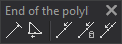

# End of the polyline
<!-- id: finalizacion-de-polilinea -->
<!-- origen: b22d538e2e31e42f237849aa5ae4664bfb41bcd1 -->

The End of the polyline toolbar runs commands related to finishing the line you are digitizing.

## Buttons

* Button that runs the command [FIN_ENT](../ventana-de-dibujo/ordenes/f/fin-ent.md).
* Button that runs the command [CLOSE_ENT](../ventana-de-dibujo/ordenes/c/cierra-ent.md).
* Button that runs the command [L](/digi3d-ai/referencia/ventana-de-dibujo/ordenes/u/u.md).
* Button that runs the command [U2](/digi3d-ai/referencia/ventana-de-dibujo/ordenes/u/u2.md).
* Button that runs the command [MU](/digi3d-ai/referencia/ventana-de-dibujo/ordenes/u/um.md).
