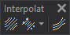

# Interpolation
<!-- id: interpolacion -->
<!-- origen: 9b167df855b71373631e8609bc0567b6c149cceb -->

Runs commands related to interpolating geometries between existing ones.

## Buttons

* Button that runs the command [INTER](/digi3d-ai/referencia/ventana-de-dibujo/ordenes/i/inter.md).
* Button that runs the command [INTERPOLATE\_COD](/digi3d-ai/referencia/ventana-de-dibujo/ordenes/i/interpolar-cod.md).
* Button that runs the command [INTER_AXIS](../ventana-de-dibujo/ordenes/i/inter-eje.md).
