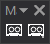
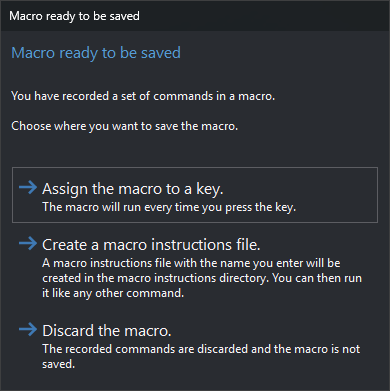
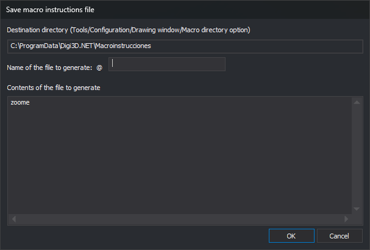

# Macro
<!-- id: macro -->
<!-- origen: 4c3ec28d574e07185d8fc50c3b63fb04a3858a74 -->

Records a command sequence to assign to a keystroke or save as a macro file.

## Buttons

* **Starts to record a macro**: records commands from this point. A red frame appears in the drawing window while recording.
* **Stops recording a macro**: finishes and opens **Macro ready to be saved**. If no commands were recorded, does nothing further.

Commands are recorded on completion with their actual parameters. A command still active when recording stops is omitted. Some internal commands are never recorded.

Some dialog-based commands, such as [DENSIFICA](../ventana-de-dibujo/ordenes/d/densifica.md), [TRANSFORM](../ventana-de-dibujo/ordenes/t/transforma.md) and [SAVE\_CODE\_TABLE](../ventana-de-dibujo/ordenes/g/guardar-tabla-codigos.md), record dialog choices as parameters. The macro uses those values without reopening the dialog. Cancelling omits the command. Other dialog commands record no chosen values and reopen their dialogs during playback.

## Macro ready to be saved dialog

Choose a destination. Neither Esc nor the window close button closes it; choose a button:

* **Save the macro in a key press.**: writes commands to a temporary file and runs [KEY](../ventana-de-dibujo/ordenes/t/tecla.md) with it. KEY requests a keystroke and opens its dialog with the recorded sequence. That key then runs the macro. Temporary file creation failure displays “Error when creating temporary file...”.
* **Create a macro instructions file.**: opens **Store macro-instructions file**. The file can later run like another command.
* **Discard the macro.**: does not save recorded commands. The next recording starts empty.

## Store macro-instructions file dialog

* **Destination directory**: read-only output folder. Uses the active project's macro directory, if specified; otherwise [Macro directory](../cuadros-de-dialogo/configuracion/diging/directorio-de-macroinstrucciones.md) under **DigiNG** in **Tools/Configuration...**. With no folder, warns that the file cannot be saved and does not open the dialog.
* **File name to be generated**: name, prefixed with `@`, the macro file prefix. Neither validated nor given an extension.
* **File contents to be generated**: recorded commands, one per line. Editable before saving.
* **OK**: writes these contents, replacing an existing file. Failure displays the operating system error.
* **Cancel**: closes without creating a file.
