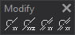

# Modify
<!-- id: modifica -->
<!-- origen: 0598d81d0fe30c63828033d375e37e07f0a1e0dd -->

Runs commands related to modifying existing geometries.

## Buttons

* Button that runs the command [MOD](/digi3d-ai/referencia/ventana-de-dibujo/ordenes/m/mod.md).
* Button that runs the command [MOD_Z](../ventana-de-dibujo/ordenes/m/mod-z.md).
* Button that runs the command [MOD_MULTIPLE](../ventana-de-dibujo/ordenes/m/mod-multiple.md).
* Button that runs the command [MOD_Z_MULTIPLE](../ventana-de-dibujo/ordenes/m/mod-z-multiple.md).
