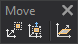

# Move
<!-- id: mover-2 -->
<!-- origen: a9bd428ac40d0aa79804fbd915d5fcc0798c2539 -->

Runs commands related to moving existing geometries.

## Buttons

* Button that runs the command [MOVE](/digi3d-ai/referencia/ventana-de-dibujo/ordenes/m/mover.md).
* Button that runs the command [MOVE_Z](../ventana-de-dibujo/ordenes/m/mover-z.md).
* Button that runs the command [CHNG_Z](../ventana-de-dibujo/ordenes/c/camb-z.md).
