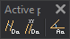

# Active parameters
<!-- id: parametros-activos -->
<!-- origen: bb61276bdae6be93bf16cba3486d8d06a749eec4 -->

Runs commands related to active parameters.

## Buttons

* Button that runs the command [AD1](/digi3d-ai/referencia/ventana-de-dibujo/variables/d/da1.md).
* Button that runs the command [AD](/digi3d-ai/referencia/ventana-de-dibujo/variables/d/da.md).
* Button that runs the command [AA](/digi3d-ai/referencia/ventana-de-dibujo/variables/a/aa.md).
