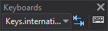

# Keyboards
<!-- id: teclados -->
<!-- origen: 98c411e4937fb5b29d066a0fcd23608c776c3077 -->

This toolbar performs actions related to [key configuration files](/digi3d-ai/primeros-pasos/primeros-pasos-usuarios-versiones-anteriores/archivos-configuracion-teclas.md).

## Buttons

* Drop-down list for switching the active keyboard among those configured to load in the [Virtual keyboards configuration](/digi3d-ai/referencia/cuadros-de-dialogo/configuracion-de-teclados-virtuales.md) dialog.
* Button that switches to the next virtual keyboard, with the same effect as the command [CHANGE_KEYS_MNU](../ventana-de-dibujo/ordenes/c/cambia-teclas-mnu.md).
* Button that runs the command [KEY](/digi3d-ai/referencia/ventana-de-dibujo/ordenes/t/tecla.md).
