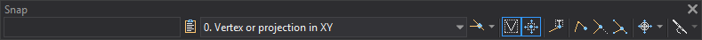

# Snap
<!-- id: tentativo -->
<!-- origen: de622e7dd2c536f15f966adba6908cc6c638b313 -->

Use this toolbar for actions related to snapping and search modes.

## Buttons

* A window showing the active snap coordinates.
* **Copy coordinates to the clipboard** copies the active snap coordinates shown in that window as text: X, Y, and Z separated by spaces, using the drawing window decimal places. Without an active snap, nothing is copied.
* A drop-down list for selecting a [search mode](../ventana-de-dibujo/variables/m/modob.md).
* A button to toggle [AUTOSMODE](/digi3d-ai/referencia/ventana-de-dibujo/ordenes/a/automodob.md).
* A button to toggle [SEE](/digi3d-ai/referencia/ventana-de-dibujo/variables/v/ver.md).
* A button to toggle [GOTO_SNAP](../ventana-de-dibujo/variables/i/ir_tentativo.md).
* A button to toggle [SNAP_TEXTS](../ventana-de-dibujo/variables/t/tentativo-textos.md).
* A button to toggle [SNAP_END](../ventana-de-dibujo/variables/t/tentativo-fin.md).
* A button to toggle [SNAP_CUTS](../ventana-de-dibujo/variables/t/tentativo-corta.md).
* A button to toggle [SNAP_INSERT](../ventana-de-dibujo/variables/t/tentativo-inserta.md).
* A button to toggle [CURSOR](/digi3d-ai/referencia/ventana-de-dibujo/ordenes/c/cursor.md).
* A button to toggle [SHOW_CONTOUR_PASS](../ventana-de-dibujo/variables/m/mostrar_paso_curvas.md).
