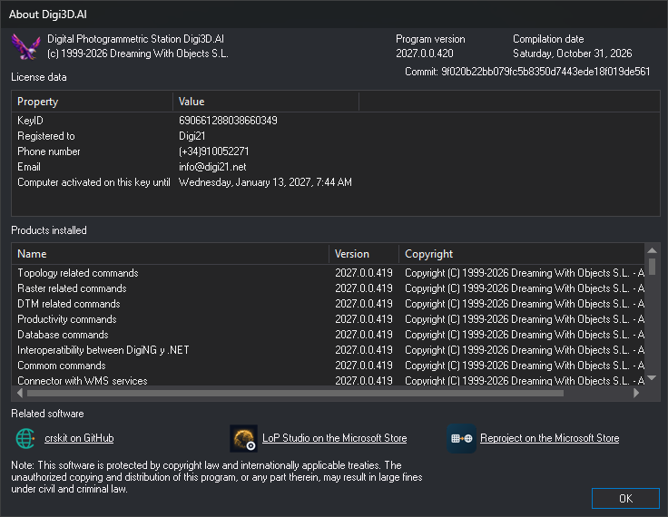

# About Digi3D.AI
<!-- id: acerca-de-digi3d-ai -->
<!-- origen: 8579f75ed0a810f53c11c0100d8acc8a9634429e -->

This dialog shows the Digi3D.AI version, license data and loaded extensions. Technical support requests this information to identify the installation.

## Opening the dialog

Select **Help/About Digi3D...**.

## Fields

* **Program version**: installed Digi3D.AI version, for example 2027.0.0.417. This is the number in the [release notes](../../novedades-version/README.md).
* **Compilation date** and **Commit**: identify the exact program build. The commit is the identifier of the source code used to build it.
* **License data**: dongle properties:
  * **KeyID**: dongle number.
  * **Registered to**, **Phone** and **Email**: details of the customer to whom the dongle is registered.
  * **Computer activated on this key until**: date until which this computer is activated on the dongle. This is the maximum date chosen when activating the computer. Absent if the computer is not activated on the dongle.
* In the version of Digi3D.AI that uses Software licenses instead of the protection dongle, check the status of the licenses in the [Software licenses](licencias-de-software.md) dialog, which you open with **Help/Software licenses...**.
* **Products installed**: the program and each loaded extension (commands, importers and exporters, photogrammetric window sensors and input devices), with name, version and copyright. The version in some **Products installed** rows, including *Digital Photogrammetric Station Digi3D.AI*, may be earlier than **Program version**.
* **Related software**: other Digi21 programs. Each link opens its page in the browser:
  * **crskit on GitHub**: repository of crskit, the coordinate reference system library used by Digi3D.AI.
  * **LoP Studio on the Microsoft Store**: LoP Studio's Microsoft Store page, from which it is installed.
  * **Reproject on the Microsoft Store**: Reproject's Microsoft Store page, from which it is installed.
* **OK**: closes the dialog.
