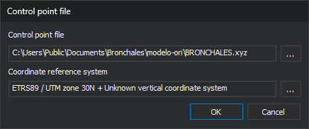

# Control point file
<!-- id: archivo-de-puntos-de-apoyo -->
<!-- origen: aca8e9391406a162a205c1152b7f7346bfa3b483 -->

This dialog specifies the file containing ground coordinates of control points and their coordinate reference system. It is opened by [ABSOLUTE\_ORI](../ventana-fotogrametrica/ordenes/o/ori-absoluta.md), aerial triangulation measurement ([AEROTRI](../ventana-fotogrametrica/ordenes/a/aerotri.md)) and the [Orientation](../paneles/orientacion.md) pane used by monoscopic, ADS40, orthophoto and satellite sensors:

* when starting orientation if the model has no control point file or Digi3D.AI cannot read it;
* when clicking the button to change the control point file in the orientation pane.

## Fields

* **Control point file**: file path. Read-only: **...** browses `.xyz`, `.pnt`, `.ctl` and `.txt` files.
* **Coordinate reference system**: system of the file's coordinates. **...** opens reference system selection.
* **OK**: uses the specified file and system.
* **Cancel**: closes the dialog. If opened when starting orientation, the command ends.

## When starting orientation

* If the file cannot be read, Digi3D.AI displays an error and reopens the dialog. For absolute orientation and aerial triangulation, the error is “Warning: Unable to load control point file: *file*”. For generic orientation, Digi3D.AI displays “Unable to load control point file.”
* **OK** with an empty path ends the command.

## When changing the file from the orientation pane

* If the new file cannot be read, Digi3D.AI displays an error and retains the previous file.
* In absolute orientation, if the new file lacks coordinates for any measured points, Digi3D.AI lists those points and asks “Accept a new control point file?”. **No** retains the previous file.
* In generic orientation, if the new file lacks a measured point, Digi3D.AI displays “Unable to locate the point: *name* in the loaded control point file.” and retains the previous file.
