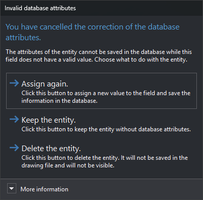

# Invalid database attributes
<!-- id: atributos-de-base-de-datos-no-validos -->
<!-- origen: 91780bc8ac04e517aaae7f1dd8b6f9d54b34e0fa -->

Digi3D.AI displays this dialog when you click **Cancel** or press Esc in [Error in user attributes](error-en-los-atributos-de-usuario.md). That dialog appears when Digi3D.AI cannot assign an attribute value to the database record, in either case:

* The field has [Allow length 0](../editor-de-tablas-de-codigos/pestanas/base-de-datos/propiedades-de-los-campos.md#allow-length-0) disabled in the code table and the attribute has no value. Digi3D.AI checks this before sending the value to the database.
* The database engine rejects the value. For example, text longer than the field size.

The dialog appears when registering a new entity in a drawing file connected to a database and when clicking **OK** in [Edit codes](../ventana-de-dibujo/ordenes/e/editar-cod.md).

## Contents

* **More information**: database table, field name and error text shown in Error in user attributes.

## Buttons

Neither Esc nor the window close button can close the dialog: you must choose one of these buttons.

* **Assign again.**: reassigns all record field values. If the field value is still invalid, Error in user attributes reappears.
* **Preserve entity.**: saves the entity in the drawing file. The failed code's record is not saved in the database: for a new entity, that code has no linked record. The entity's other codes are stored normally.
* **Delete entity.**: discards a new entity: it is neither saved in the drawing file nor displayed. If the dialog appears after clicking **OK** in Edit codes, Digi3D.AI closes the editor and deletes the entity from the drawing file. Recover it with [UNDO](../ventana-de-dibujo/ordenes/u/undo.md).

## From the Edit codes dialog

* **Preserve entity.**: the editor closes and the entity retains the editor's changes. The failed code's record retains its previous database values.
* **Delete entity.**: records for codes before the failed code have already been saved in the database. Deleting the entity does not delete those records.
