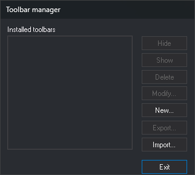
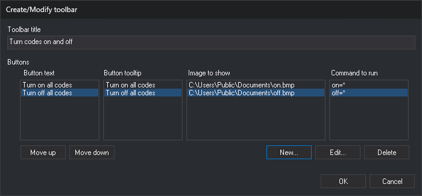
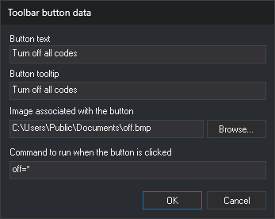

# User toolbars
<!-- id: barras-de-herramientas-de-usuario -->
<!-- origen: 3fec54f48ed60b8287d4103d77ab52bdd0384bee -->

User toolbars contain buttons that run Digi3D.AI commands. Each _Windows_ user has separate toolbars.

Their buttons are disabled while no drawing or photogrammetric window is open.

## Toolbar manager

Select **Tools/User toolbars...** to open this dialog. It shows **Installed toolbars** and the buttons below. Buttons acting on a toolbar are disabled until one is selected:

* **New...**: opens [Create/Modify toolbar](#createmodify-toolbar) to create a toolbar.
* **Modify...**: opens the same dialog with the selected toolbar's data.
* **Delete**: deletes the toolbar without confirmation.
* **Show** and **Hide**: show or hide the toolbar in the main window.
* **Export...**: requests a folder and creates a folder named **BarraHerramientas** followed by the toolbar title. Saves its definition as **BarraHerramientas.ini** there, with copies of button images.
* **Import...**: requests a folder exported with **Export...** and adds its toolbar. If it has no **BarraHerramientas.ini**, or the file defines no buttons, no toolbar is added and no warning appears.
* **Exit**: closes the dialog. Changes take effect immediately, without accepting.

## Create/Modify toolbar

* **Toolbar title**: title displayed by the toolbar.
* **Buttons**: toolbar buttons, in display order. Each row in the four lists represents a button; selecting it in any list selects it in all four:
  * **Button text**: text shown on the button.
  * **Button tooltip**: text shown when the mouse rests over the button.
  * **Image to be shown**: button image file.
  * **Command to be run**: command run when clicked.
* **Move up** and **Move down**: change the selected button's position.
* **New...**: opens [Toolbar button data](#toolbar-button-data) and appends a button.
* **Edit...**: opens the same dialog with the selected button's data.
* **Delete**: deletes the selected button.
* **OK**: saves the toolbar. **Cancel** discards changes.

A toolbar saved without buttons is not recreated the next time Digi3D.AI starts.

## Toolbar button data

* **Button text**: text shown on the button.
* **Button tooltip**: text shown when the mouse rests over the button.
* **Image associated with the button**: button image file. Digi3D.AI scales it to 16×16 pixels. **Examine...** opens file selection with **Bitmap files** (`.bmp`) and **All files** filters. Although **All files** allows other formats, Digi3D.AI loads only BMP images.
* **Command to be run when button clicked**: command and parameters as entered on the command line.
* **OK**: saves the button data. Disabled when:
  * **Button tooltip** is empty.
  * Both **Button text** and **Image associated with the button** are empty.
  * The file under **Image associated with the button** does not exist.
  * **Command to be run when button clicked** is empty.
