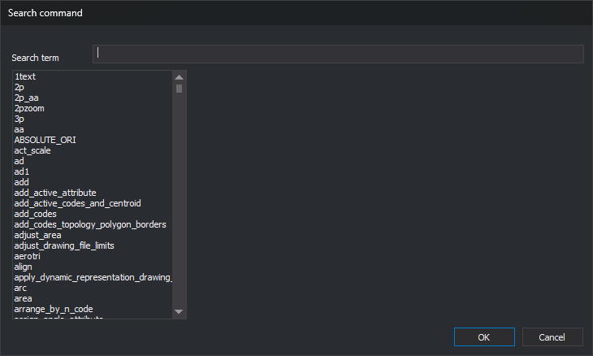

# Search command
<!-- id: buscar-orden -->
<!-- origen: a202e66d04309e36014ee6a668af8d85daa825fe -->

This dialog searches for a command by name or description. It is opened by:

* **Immediate/Run a command by its name...**. Accepting makes Digi3D.AI run the selected command.
* **Search...** in the status bar, next to **Command** when Digi3D.AI requests a command to run. Accepting writes the command name in that field without running it.
* **Search...** in **Command assigned to button**, opened from [Programming buttons](programar-botones.md). Accepting writes the command name in **Command to be run**. The command is assigned to the button when you click **OK** in **Command assigned to button**.

## Fields

* **Search term**: text to find, ignoring case. The list shows commands whose names or descriptions contain it. For photogrammetric window commands, only the name is searched.
* **Command list**: drawing window commands and, if a photogrammetric window is active, its commands too. The list is alphabetical.
* **Description**: selected command title and description. Empty for a photogrammetric window command.
* **OK**: chooses the selected command. With none selected, equivalent to **Cancel**. Double-clicking a command is equivalent to selecting it and clicking **OK**.
* **Cancel**: closes the dialog without choosing a command.
