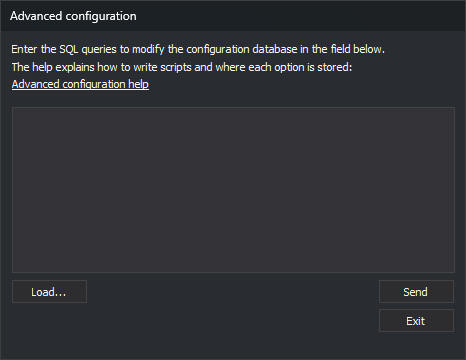

# Advanced configuration
<!-- id: configuracion-avanzada -->
<!-- origen: fa0d4f940dd63652fdaf964985232e93c93046b9 -->



This dialog box runs SQL statements on the [Digi3DNET.db configuration file](../archivos/archivo-de-configuracion-digi3dnet.db.md), which stores settings shared by all users of the computer. Use it to apply a set of configuration changes prepared in a script at once.

The page for each option in the [Configuration](configuracion/README.md), [Configure projects](configurar-proyectos.md), and [Input device configuration](configuracion-de-dispositivos-de-entrada.md) dialog boxes specifies, under **Where it is stored**, where the option is stored and the SQL statements that change it.

## Open the dialog box

Select **Tools/Advanced configuration...** from the menu. This option only appears in the menu Digi3D.AI displays when no drawing or photogrammetric window is open.

## Use the dialog box

1. Enter SQL statements in the text field, or click **Load...** and select a `.sql` file. The **Open** dialog box opens in the folder from which you last loaded a file. The file is read as UTF-8, and its contents replace the text in the field.
2. Click **Send** to run the statements.
3. Click **Exit** to close the dialog box.

When you click **Send**, Digi3D.AI processes the text field one line at a time:

* Each line is executed separately. A statement cannot span multiple lines. A line can contain multiple statements separated by `;`.
* Lines starting with `--` are comments and are not executed.
* Empty lines are skipped.
* Only the first 256 nonempty lines are processed. Comment lines count toward this limit. Subsequent lines are not executed, and Digi3D.AI does not issue a warning.
* If a statement fails, Digi3D.AI displays the SQLite error message and continues with the next line. Statements following the failed statement on the same line are not executed. Statements on previous lines have already been applied.
* If no statements fail, Digi3D.AI does not display a message.

## Database structure

| Table | Contents |
| :--- | :--- |
| `Keys` | One row per configuration folder. `Id` is its identifier and `Path` its path, such as `App\Configuration` or `DigiNG\Configuration`. |
| `Ints` | Integer values. `Key` is the folder's `Id`, `Value` is the value name, and `Data` is the number. |
| `Doubles` | Real values, with the same columns as `Ints`. |
| `Texts` | Text values, with the same columns as `Ints`. |
| `Blobs` | Binary values, with the same columns as `Ints`. |

For example, this line sets the integer value `FullMDI3D` in the `App\Configuration` folder to 1:

```sql
UPDATE Ints SET Data = 1 WHERE Value = 'FullMDI3D' AND Key = (SELECT Id FROM Keys WHERE Path = 'App\Configuration');
```

A value that Digi3D.AI has never read has no row in its table. In that case, `UPDATE` changes nothing, and you must add the row with `INSERT`.

The **Where it is stored** section on each option's page specifies its folder, table, value name, default value, and the three statements that assign it. If the option is stored in the _Windows_ registry rather than this database, the section states this. The [Configuration file values](../archivos/valores-del-archivo-de-configuracion-digi3dnet.db.md) page lists values without an option page, such as those that can only be changed through SQL.

## Write a script

* Copy paths from the `Path` column with the same capitalization. SQLite is case-sensitive with `=` and case-insensitive with `LIKE`. The same folder may appear with two spellings: the DGN format's `Order` value is in `DigiNG\IO\Digi21.Io.DGN`, whereas the DGN importer options are in `DigiNG\IO\Digi21.Io.Dgn`.
* Write paths with a single backslash. SQLite does not use `\` as an escape character.
* To assign a value whether or not its row exists, use these three lines. The first creates the folder if it does not exist, the second deletes any rows for the value, and the third adds a row with the new value. If a value has multiple rows, Digi3D.AI uses only one of them, so adding another is insufficient:

```sql
INSERT OR IGNORE INTO Keys (Path) VALUES ('DigiNG\Configuration');
DELETE FROM Ints WHERE Value = 'NombreDelValor' AND Key = (SELECT Id FROM Keys WHERE Path = 'DigiNG\Configuration');
INSERT INTO Ints (Key, Value, Data) SELECT Id, 'NombreDelValor', 1 FROM Keys WHERE Path = 'DigiNG\Configuration';
```

* To restore a value to its initial state, delete its row. The next time Digi3D.AI reads it, it uses the value written by the installer to **HKEY\_LOCAL\_MACHINE**, or the program's default value if the installer did not write one.
* The dialog box does not display `SELECT` query results. To query the database, open it with _DB Browser for SQLite_.
* Save `.sql` files as UTF-8 without a BOM.
* After running a script, close Digi3D.AI and reopen it. Many values are only read at startup. Digi3D.AI also reads importer options at startup, and clicking **Accept** in the **Configuration** dialog box saves them again with the values read: without restarting, this dialog box would overwrite the values just written by the script.

## More examples

Copy each script into the text field and click **Send**.

### Choose the default drawing file format

Digi3D.AI sorts drawing file formats in ascending order by the integer `Order` value in the `DigiNG\IO\<formato>` folder. The first format in the list is suggested by the save dialog boxes. This script assigns 1 to all formats and 0 to DGN:

```sql
-- This script sets DGN as the default Digi3D.AI file format
UPDATE Ints SET Data=1 WHERE Value='Order' AND Key IN (SELECT Id FROM Keys WHERE Path LIKE 'DigiNG\IO\%');
UPDATE Ints SET Data=0 WHERE Value='Order' AND Key IN (SELECT Id FROM Keys WHERE Path LIKE 'DigiNG\IO\Digi21.Io.Dgn');
```

To choose another format, change the folder name in the last line: `Digi21.Io.Dwg` (DWG), `Digi21.Io.Bin` (single-precision binary, _.bin_), `Digi21.Io.BinDouble` (double-precision binary, _.bind_), or `Digi21.Io.Shp` (Shapefile).

The last line uses `Key IN (...)` rather than `Key = (...)`: `LIKE` finds both DGN format folders, `Digi21.Io.DGN` and `Digi21.Io.Dgn`, and with `=`, SQLite would only use the first, which may not contain the `Order` value.

Formats with the same `Order` value have no fixed order relative to each other. To also specify the second and third formats, use the [Set the order of multiple formats](#set-the-order-of-multiple-formats) script.

### Set the order of multiple formats

This script puts DGN first, Shapefile second, and DWG third. The remaining formats follow in no fixed order:

```sql
UPDATE Ints SET Data = 3 WHERE Value = 'Order' AND Key IN (SELECT Id FROM Keys WHERE Path LIKE 'DigiNG\IO\%');
UPDATE Ints SET Data = 0 WHERE Value = 'Order' AND Key IN (SELECT Id FROM Keys WHERE Path LIKE 'DigiNG\IO\Digi21.Io.Dgn');
UPDATE Ints SET Data = 1 WHERE Value = 'Order' AND Key IN (SELECT Id FROM Keys WHERE Path LIKE 'DigiNG\IO\Digi21.Io.Shp');
UPDATE Ints SET Data = 2 WHERE Value = 'Order' AND Key IN (SELECT Id FROM Keys WHERE Path LIKE 'DigiNG\IO\Digi21.Io.Dwg');
```

### Restore the installer's format order

This script deletes the `Order` value for all formats. At the next startup, Digi3D.AI reads the order written by the installer, in which double-precision binary is the default format:

```sql
DELETE FROM Ints WHERE Value = 'Order' AND Key IN (SELECT Id FROM Keys WHERE Path LIKE 'DigiNG\IO\%');
```

### Hide the import and export parameters dialog box

When a command requests a drawing file, such as [EXPORT](../ventana-de-dibujo/ordenes/e/exportar.md), [INS](../ventana-de-dibujo/ordenes/i/ins.md), or [BLOCK](../ventana-de-dibujo/ordenes/b/bloque.md), Digi3D.AI displays a dialog box with the format's import or export parameters after you select the file. With this script, Digi3D.AI skips that dialog box and uses the parameters saved for the format:

```sql
INSERT OR IGNORE INTO Keys (Path) VALUES ('DigiNG\Configuration');
DELETE FROM Ints WHERE Value = 'UtilizarParametrosImportacionExportacionPreconfigurados' AND Key = (SELECT Id FROM Keys WHERE Path = 'DigiNG\Configuration');
INSERT INTO Ints (Key, Value, Data) SELECT Id, 'UtilizarParametrosImportacionExportacionPreconfigurados', 1 FROM Keys WHERE Path = 'DigiNG\Configuration';
```

To display the dialog box again, run the same script with 0 instead of 1 on the last line.

### Add unknown codes to the code table for all formats

When opening a file, importers assign each entity a code from the code table. If they cannot find a code matching the entity, they create one. This script makes all importers with the **Add unknown codes** option add these new codes to the active code table: single-precision binary, double-precision binary, DGN, DWG, FileGDB, GeoMedia, GeoPackage, KML, PostGIS, Shapefile, and VEC.

```sql
UPDATE Ints SET Data = 1 WHERE Value = 'AñadirCódigosDesconocidos' AND Key IN (SELECT Id FROM Keys WHERE Path LIKE 'DigiNG\IO\%');
```

Digi3D.AI creates a row for this value at startup for each active importer, so `UPDATE` is sufficient. To disable the option for all formats, run the same line with `Data = 0`.

### Display a progress window when saving DGN files

With this script, Digi3D.AI displays a modal dialog box while writing a DGN file. This is the same value written by the [Show modal when saving](configuracion/importador-exportador-de-archivos-bentley-microstation-v8/mostrar-modal-al-guardar.md) option in the **Configuration** dialog box:

```sql
INSERT OR IGNORE INTO Keys (Path) VALUES ('DigiNG\IO\Digi21.Io.Dgn');
DELETE FROM Ints WHERE Value = 'MostrarModalAlGuardar' AND Key = (SELECT Id FROM Keys WHERE Path = 'DigiNG\IO\Digi21.Io.Dgn');
INSERT INTO Ints (Key, Value, Data) SELECT Id, 'MostrarModalAlGuardar', 1 FROM Keys WHERE Path = 'DigiNG\IO\Digi21.Io.Dgn';
```

### Load additional exterior rings in 3D shapefile polygons as holes

A record in a 3D polygon shapefile (_PolygonZ_) can contain multiple exterior rings. Digi3D.AI loads it as a complex entity with one polygon per exterior ring. With this script, it loads the record as a single polygon: the first exterior ring is the boundary, and the other exterior rings become holes in that polygon. Holes belonging to the additional exterior rings are discarded.

Use this for files that store holes with the orientation of an exterior ring. It does not affect 2D polygon shapefiles or polygon shapefiles with measures (_PolygonM_).

```sql
INSERT OR IGNORE INTO Keys (Path) VALUES ('DigiNG\IO\Digi21.Io.Shp');
DELETE FROM Ints WHERE Value = 'ConsiderarMultiPoligonosComoPoligonos' AND Key = (SELECT Id FROM Keys WHERE Path = 'DigiNG\IO\Digi21.Io.Shp');
INSERT INTO Ints (Key, Value, Data) SELECT Id, 'ConsiderarMultiPoligonosComoPoligonos', 1 FROM Keys WHERE Path = 'DigiNG\IO\Digi21.Io.Shp';
```

### Disable unused formats

At startup, Digi3D.AI loads drawing file formats whose `Activated` value is 1. This script disables PDF and SVG. These formats disappear from the open and save dialog boxes, and Digi3D.AI cannot open or export files in them:

```sql
UPDATE Ints SET Data = 0 WHERE Value = 'Activated' AND Key IN (SELECT Id FROM Keys WHERE Path IN ('DigiNG\IO\Digi21.Io.Pdf', 'DigiNG\IO\Digi21.Io.Svg'));
```

Do not disable the format of your working files or their reference files. To enable a format again, run the same line with `Data = 1`.

## Notes

* Changes affect all users of the computer. Per-user settings are stored in the _Windows_ registry under **HKEY\_CURRENT\_USER**. SQL statements do not change them. The dialog box only stores the last folder used with **Load...** there.
* The dialog box does not undo changes. Before running a script, back up **C:\ProgramData\Digi3D.NET\Digi3DNET.db**.
* If a change has no effect, close Digi3D.AI and reopen it.
