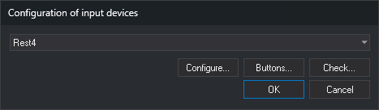
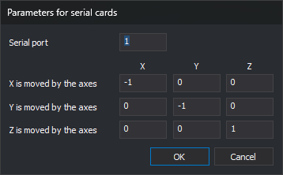
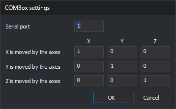
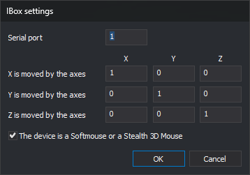
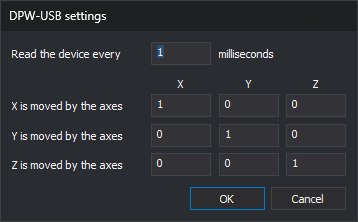
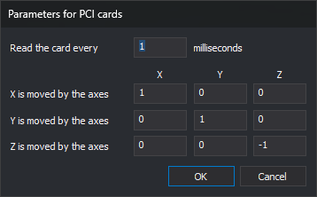
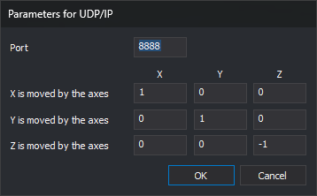
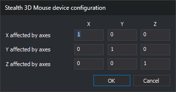
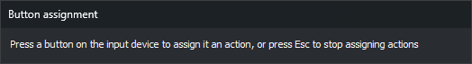
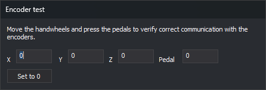

# Configuration of input devices
<!-- id: configuracion-de-dispositivos-de-entrada -->
<!-- origen: ef7540e6c78ed273dc033a63502cee73e65d5fb1 -->



This dialog selects the input device used for digitizing in the photogrammetric window (handwheels, pedals, 3D mice, etc.), configures it, and checks that it communicates with Digi3D.AI.

This differs from the [Input devices](configuracion/dispositivos-de-entrada/README.md) section of the **Configuration** dialog.

## Opening the dialog

Select **Tools/Configuration of input devices...** from the menu. This option only appears in the menu Digi3D.AI displays when no drawing or photogrammetric window is open.

The dialog also opens when opening a photogrammetric window if Digi3D.AI cannot communicate with the selected input device. In that case, **Error when connecting to input device** appears, with three options:

* **Attempt to connect again to device %1.**: tries communicating again.
* **Configure input device.**: opens this dialog. On closing it, Digi3D.AI tries communicating with the selected device.
* **Continue.**: opens the photogrammetric window without an input device.

## Fields

* **Drop-down list**: input devices supported by the installed extensions. **None** means no input device is used.
* **Configure...**: opens the selected device configuration dialog. Disabled if the device has no parameters to configure.
* **Buttons...**: opens **Button assignment**.
* **Check...**: opens **Encoder test**.
* **OK**: saves the selected device and closes the dialog.
* **Cancel**: closes the dialog without changing the device.

**Configure...**, **Buttons...**, and **Check...** are disabled when **None** is selected.

**Buttons...** and **Check...** communicate with the device before opening their dialogs. If communication fails, Digi3D.AI displays **Error when connecting to input device** with the error description, and the dialog does not open.

## Configure: device parameters

Each device has its own configuration dialog. Devices connected through a serial port (Rest4, FCodic, TopoMouse Serie, and SEC-232m) display **Parameters for serial cards**:



* **Serial port**: number of the COM port to which the device is connected.
* **X is moved by the axes**, **Y is moved by the axes**, and **Z is moved by the axes**: how much each cursor coordinate (rows) changes when moving each device axis (**X**, **Y**, and **Z** columns). A negative value reverses the direction. For example, `-1` in the Z row and Z column makes the Z handwheel move the cursor in the opposite direction.

Other device dialogs have the same axis table and, in the first row, the parameter specific to each device:

| Device | Dialog | First row |
| --- | --- | --- |
| COMBox | **COMBox settings** | **Serial port** |
| IBox | **IBox settings** | **Serial port**. Adds **The device is a Softmouse or a Stealth 3D Mouse**, which rotates the device X and Y axes by 45°. |
| DPW | **Parameters for PCI cards** | **Read the card every** _n_ **milliseconds**: time between card readings. |
| DPW-USB | **DPW-USB settings** | **Read the device every** _n_ **milliseconds**: time between device readings. |
| UDP/IP | **Parameters for UDP/IP** | **Port**: UDP port on which Digi3D.AI receives coordinates. |
| Stealth 3D Mouse S1Z/S2Z/S3Z | **Stealth 3D Mouse device configuration** | None: only the axis table, whose rows are **X affected by axes**, **Y affected by axes**, and **Z affected by axes**. |
| TopoMouse USB | **TopoMouse USB device configuration** | None: only the axis table, whose rows are **X affected by axes**, **Y affected by axes**, and **Z affected by axes**. |














If a device configuration has never been saved, the dialog displays the device defaults. **OK** saves the values, and **Cancel** closes the dialog without saving them.

Each device saves its configuration separately. Stealth 3D Mouse and TopoMouse USB configuration is saved for the _Windows_ user; other device configuration is saved for the computer.

## Buttons: Button assignment



1. Press a device button or pedal. **Command assigned to button** opens, as described in [Programming buttons](programar-botones.md).
2. Choose the action or command that the button runs and click **OK**.
3. Repeat for each button you want to program.
4. Press **Esc** to finish.

Each assignment is saved when you click **OK** in **Command assigned to button**. Clicking **Cancel** in **Configuration of input devices** does not undo assignments.

## Check: Encoder test



Displays the **X**, **Y**, **Z**, and **Pedal** values sent by the device. Move the handwheels and press the pedals to check that the values change. **Set to 0** resets the counters to zero. The dialog has no close button: close it with **Esc**.

## Notes

* The selected device is saved for the _Windows_ user, rather than the computer.
* To configure mice, joysticks, and controllers detected by _Windows_ as HID devices, use [Mouse, joystick, and controller configuration](configuracion-de-ratones-joysticks-y-mandos.md).

<details>
<summary>Where it is stored</summary>

The selected device is saved in the _Windows_ registry for the user:

| Registry | `HKEY_CURRENT_USER\Software\Digi21\Digi3D.NET\App\Configuration` |
| :--- | :--- |
| Value | `Codificadores` |
| Type | `REG_SZ` (device name, as displayed in the drop-down list) |
| Default value | (empty): no device |

Stealth 3D Mouse and TopoMouse USB parameters are also saved in the _Windows_ registry for the user. They are three `REG_SZ` values, `TensorX`, `TensorY`, and `TensorZ`, containing the axis table rows as numbers separated by spaces:

| Device | Registry key |
| :--- | :--- |
| Stealth 3D Mouse S1Z/S2Z/S3Z | `HKEY_CURRENT_USER\Software\Digi21\Digi3D.NET\Digi3D\IO\Digi3D.IO.S1Z` |
| TopoMouse USB | `HKEY_CURRENT_USER\Software\Digi21\Digi3D.NET\Digi3D\IO\Digi3D.IO.TopoMouseUsb` |

The defaults are `1 0 0 0` for `TensorX`, `0 1 0 0` for `TensorY`, and `0 0 1 0` for `TensorZ`.

Other device parameters are shared by all computer users and saved in the [Digi3DNET.db configuration file](../archivos/archivo-de-configuracion-digi3dnet.db.md), in one folder per device. These SQL statements set serial port 3 for IBox, whether or not the row exists. Run them in [Advanced configuration](configuracion-avanzada.md) and restart Digi3D.AI:

```sql
INSERT OR IGNORE INTO Keys (Path) VALUES ('Digi3D\IO\TarjDigi3D\IBox');
DELETE FROM Ints WHERE Value = 'PuertoSerieCodificadores' AND Key = (SELECT Id FROM Keys WHERE Path = 'Digi3D\IO\TarjDigi3D\IBox');
INSERT INTO Ints (Key, Value, Data) SELECT Id, 'PuertoSerieCodificadores', 3 FROM Keys WHERE Path = 'Digi3D\IO\TarjDigi3D\IBox';
```

### Folder `Digi3D\IO\TarjDigi3D\<dispositivo>`

`<dispositivo>` is the name of the configured input device (generic serial card, ISA, DPW USB, etc.). The following folders, named after individual devices, contain the same values.

| Value | Table | Default | What it does |
| :--- | :--- | :--- | :--- |
| `BombardeoCodificadores` | `Ints` | 1 | Milliseconds between device encoder readings. |
| `PuertoSerieCodificadores` | `Ints` | 1 | Device serial port number. |
| `TensorX` | `Texts` | depends on the device | X row of the matrix transforming encoder readings into displacements. Four space-separated numbers. |
| `TensorY` | `Texts` | depends on the device | Y row of the matrix transforming encoder readings into displacements. |
| `TensorZ` | `Texts` | depends on the device | Z row of the matrix transforming encoder readings into displacements. |

### Folder `Digi3D\IO\TarjDigi3D\DatEmComBox`

| Value | Table | Default | What it does |
| :--- | :--- | :--- | :--- |
| `PuertoSerieCodificadores` | `Ints` | 1 | Device serial port number. |
| `TensorX` | `Texts` | depends on the device | X row of the matrix transforming encoder readings into displacements. Four space-separated numbers. |
| `TensorY` | `Texts` | depends on the device | Y row of the matrix transforming encoder readings into displacements. |
| `TensorZ` | `Texts` | depends on the device | Z row of the matrix transforming encoder readings into displacements. |

### Folder `Digi3D\IO\TarjDigi3D\DPW`

| Value | Table | Default | What it does |
| :--- | :--- | :--- | :--- |
| `BombardeoCodificadores` | `Ints` | 1 | Milliseconds between device encoder readings. |
| `TensorX` | `Texts` | depends on the device | X row of the matrix transforming encoder readings into displacements. Four space-separated numbers. |
| `TensorY` | `Texts` | depends on the device | Y row of the matrix transforming encoder readings into displacements. |
| `TensorZ` | `Texts` | depends on the device | Z row of the matrix transforming encoder readings into displacements. |

### Folder `Digi3D\IO\TarjDigi3D\DPWUsb`

| Value | Table | Default | What it does |
| :--- | :--- | :--- | :--- |
| `BombardeoCodificadores` | `Ints` | 1 | Milliseconds between device encoder readings. |
| `TensorX` | `Texts` | depends on the device | X row of the matrix transforming encoder readings into displacements. Four space-separated numbers. |
| `TensorY` | `Texts` | depends on the device | Y row of the matrix transforming encoder readings into displacements. |
| `TensorZ` | `Texts` | depends on the device | Z row of the matrix transforming encoder readings into displacements. |

### Folder `Digi3D\IO\TarjDigi3D\IBox`

| Value | Table | Default | What it does |
| :--- | :--- | :--- | :--- |
| `DispositivoEsMouse` | `Ints` | 1 | If 1, IBox works as a mouse. |
| `PuertoSerieCodificadores` | `Ints` | 1 | Device serial port number. |
| `TensorX` | `Texts` | depends on the device | X row of the matrix transforming encoder readings into displacements. Four space-separated numbers. |
| `TensorY` | `Texts` | depends on the device | Y row of the matrix transforming encoder readings into displacements. |
| `TensorZ` | `Texts` | depends on the device | Z row of the matrix transforming encoder readings into displacements. |

### Folder `Digi3D\IO\TarjDigi3D\SEC-232m`

| Value | Table | Default | What it does |
| :--- | :--- | :--- | :--- |
| `PuertoSerieCodificadores` | `Ints` | value of `Digi3D\IO\TarjDigi3D\PuertoSerieCodificadores` | Device serial port number. |
| `TensorX` | `Texts` | depends on the device | X row of the matrix transforming encoder readings into displacements. Four space-separated numbers. |
| `TensorY` | `Texts` | depends on the device | Y row of the matrix transforming encoder readings into displacements. |
| `TensorZ` | `Texts` | depends on the device | Z row of the matrix transforming encoder readings into displacements. |

### Folder `Digi3D\IO\TarjDigi3D\UdpIp`

| Value | Table | Default | What it does |
| :--- | :--- | :--- | :--- |
| `Puerto` | `Ints` | 8888 | UDP port on which Digi3D.AI receives coordinates. |
| `TensorX` | `Texts` | depends on the device | X row of the matrix transforming encoder readings into displacements. Four space-separated numbers. |
| `TensorY` | `Texts` | depends on the device | Y row of the matrix transforming encoder readings into displacements. |
| `TensorZ` | `Texts` | depends on the device | Z row of the matrix transforming encoder readings into displacements. |

Button assignments from **Buttons...** are saved as described in [Programming buttons](programar-botones.md).

</details>
