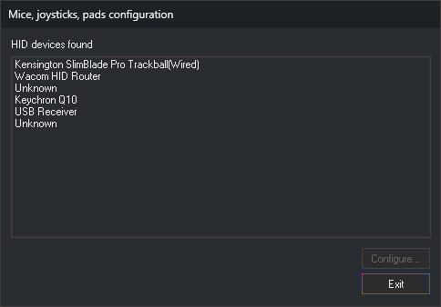
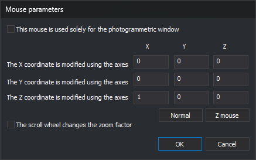
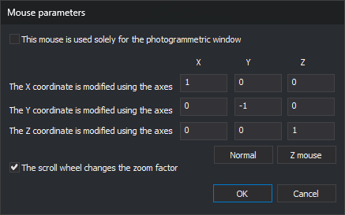

# Mice, joysticks, pads configuration
<!-- id: configuracion-de-ratones-joysticks-y-mandos -->
<!-- origen: d74c2c640f0c83685f5c129f711134280fd3b19c -->

This dialog configures how mice, joysticks, and controllers detected by _Windows_ as HID devices move the photogrammetric window cursor.

## Opening the dialog

Select **Tools/Configuration of mice, joysticks, pads, ...** from the menu. This option only appears in the menu Digi3D.AI displays when no drawing or photogrammetric window is open.

## Fields

* **HID devices found**: mice, joysticks, and controllers connected to the computer, with the product name supplied by each device. If a device supplies no name, it appears as **Unknown**. The list is populated when Digi3D.AI starts: a device connected afterward does not appear until the program restarts. A joystick Digi3D.AI cannot open does not appear in the list.
* **Configure...**: opens the selected device parameters. Disabled while no device is selected. Opens **Mouse parameters** for a mouse and **Device parameters** for any other device.
* **Exit**: closes the dialog.

## Mouse parameters and Device parameters

The coefficient table specifies how much each cursor coordinate (X, Y, and Z rows) changes when moving each device axis (X, Y, and Z columns). For example, 1 in the Y row and X column makes movement along the device X axis change the cursor Y coordinate. A negative value reverses the direction.

If the device has no saved parameters, the table contains `1 0 0` in row X, `0 -1 0` in row Y, and `0 0 1` in row Z: each axis moves its corresponding coordinate, with Y reversed.

Example: a trackball dedicated to Z. With **Z mouse**, moving the ball left and right raises and lowers Z (row Z, column X = 1):

Example: a mouse for X and Y. With **Normal**, the mouse moves cursor X and Y. In this screenshot, **The scroll wheel changes the Zoom Factor** is checked, so the wheel changes zoom. With this checkbox cleared, the wheel changes Z (row Z, column Z = 1):

**Mouse parameters** adds:

* **Normal**: the mouse X axis moves cursor X, Y moves cursor Y in the opposite direction, and Z (the wheel) moves cursor Z.
* **Z mouse**: horizontal mouse movement changes cursor Z, and no axis moves X or Y. This lets you dedicate a second mouse to Z.
* **The scroll wheel changes the Zoom Factor**: turning the wheel forward runs ZOOMIN in the photogrammetric window; turning it backward runs ZOOMOUT. With this option checked, the wheel does not act as the Z axis.
* **This mouse is used solely for the photogrammetric window**: Digi3D.AI saves this option, but it has no effect: the mouse only moves the photogrammetric window cursor while that window has captured it, whether checked or not.

Click **OK** to save parameters or **Cancel** to discard them.

## Notes

* Parameters are saved for the _Windows_ user and device product name. Two devices with the same name share parameters.
* To assign commands to mouse buttons, use [Programming buttons](programar-botones.md).
