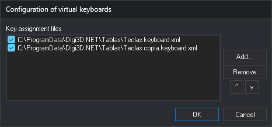

# Configuration of virtual keyboards
<!-- id: configuracion-de-teclados-virtuales -->
<!-- origen: 05bc1a6cb9af78c431142dcd1fd6648ee4c8f8e9 -->

This dialog specifies which key assignment files (`.keyboard.xml`) Digi3D.AI loads and in what order.

## Opening the dialog

Select **Tools/Configure virtual keyboards...**. This option appears only in the menu shown when no drawing or photogrammetric window is open. It is disabled when projects are enabled.

## Fields

* **Key assignment files**: configured files, in loading order. The checkbox to each file's left determines whether it is loaded. Clear it to stop loading a file without removing it from the list.
* **Add...**: selects a `.keyboard.xml` file and appends it to the list with its checkbox selected. A file already in the list is not added again.
* **Remove**: removes the selected file from the list.
* **^** and **v**: move the selected file up or down one position.
* **OK**: saves the list for the current _Windows_ user; each computer user has a separate list.
* **Cancel**: closes without saving changes.

## Notes

When opening a drawing or photogrammetric window, Digi3D.AI loads every checked file in the list. When projects are enabled, Digi3D.AI does not use this list: it loads only the file specified in **Keyboard** in the project configuration (see [Configure projects](configurar-proyectos.md)).

If a file cannot be loaded, Digi3D.AI displays “Unable to load a key configuration file”, with the file path and the cause in **More information**, and continues with the next file.

If several files are loaded, switch between them with:

* [CHANGE_KEYS_MNU](../ventana-de-dibujo/ordenes/c/cambia-teclas-mnu.md).
* The [Keyboards toolbar](../barras-de-herramientas/teclados.md) drop-down list.
