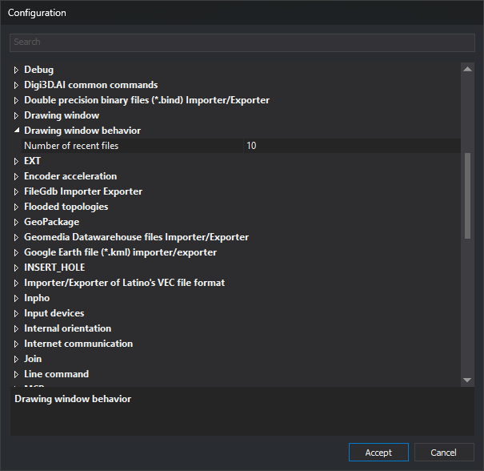

# Configuration
<!-- id: configuracion -->
<!-- origen: 1e7fff9233a91f7fad0f2370809c9f977cebf144 -->

This dialog configures Digi3D.AI.

## Opening the dialog

To open this dialog, select **Tools/Configuration...** from the menu.

## Using the dialog

Settings are grouped by category.

To change an option:

* Find the category containing the option you want to change.
* Open the category by double-clicking it or clicking the arrow on the left.
* Find the parameter you want to change within the category.
* Change the value.
* Click **Accept**.

The dialog also contains these elements:

* **Search**: filters options by text, ignoring case. Accented vowels are treated distinctly: for example, `area` does not match the Spanish label **Área**. Displays options whose names contain the text and their containing categories, and expands those categories. If the text appears in a category name, that category is displayed collapsed, with all its options. With the field empty, all categories are displayed collapsed.
* **Description area**: the bottom of the dialog displays the selected item name in bold, followed by its description. Categories and some options have no description and display only the name.
* **Accept**: saves changes. If Digi3D.AI is not running as administrator, the button displays the _Windows_ User Account Control shield.
* **Cancel**: closes the dialog without saving changes. Options added by some extensions, such as [EXT can extend out of bounds](ext/ext-puede-extender-fuera-de-limites.md), are not saved, but Digi3D.AI uses the new value until the application closes.

Pressing F1 opens the help page for the selected option. If the option has no assigned page, the category page opens or, if it has none either, this page.

On acceptance, if you changed an option that requires a restart, for example **Theme**, **One monitor configuration**, **Interface for selecting code**, or **Drawing order (multiple code)**, Digi3D.AI displays “Changes will not be visible until you restart the application”.

## Configuration options

Options are grouped into the following sections. Click each option title for a detailed explanation of its meaning and accepted values.

### Encoder acceleration

Accelerates image movement when turning the handwheels.

* **[Sampling time for acceleration](aceleracion-de-manivelas/tiempo-de-muestreo-para-aceleracion.md)** — Time in milliseconds for acceleration calculations.
* **[Presses](aceleracion-de-manivelas/pulsos.md)** — Minimum number of pulses that trigger acceleration.
* **[Multiplication factor](aceleracion-de-manivelas/factor-de-multiplicacion.md)** — Value by which speed is multiplied when accelerating.
* **[Stop time](aceleracion-de-manivelas/tiempo-de-parada.md)** — Period without movement after which acceleration ends.

### Reference files

Configures what Digi3D.AI saves in the reference files file of each drawing file.

* **[Store the reference files in a .reference_files.json file](archivos-de-referencia/almacenar-los-archivos-de-referencia-en-un-archivo-json.md)** — Saves the drawing reference files, with their import parameters and transformations, and loads them when opening the drawing file.
* **[Store the photogrammetric project or the photogrammetric model as a reference file](archivos-de-referencia/almacenar-el-proyecto-o-el-modelo-fotogrametrico.md)** — Saves the photogrammetric project or photogrammetric model file path, and loads that project or opens that model when opening the drawing file.

### Arcs and circles

Configures how arcs and circles are generated.

* **[Minimum number of points](arcos-y-circunferencias/minimo-de-puntos.md)** — Minimum number of vertices in an arc.
* **[Maximum number of points](arcos-y-circunferencias/maximo-de-puntos.md)** — Maximum number of vertices in an arc.

### AI assistant

Configures the AI chat pane: each provider URL and API key, and pane behavior.

* **[URL](asistente-de-ia/url-del-proveedor-de-ia.md)** — Base address of a provider API.
* **[API key](asistente-de-ia/clave-de-api-del-proveedor-de-ia.md)** — Key supplied by the provider for using its API.
* **[Show run_python code](asistente-de-ia/mostrar-codigo-run-python.md)** — Displays the Python code run by the assistant in the chat.
* **[Show token counter](asistente-de-ia/mostrar-contador-de-tokens.md)** — Displays conversation token counts in the pane header.
* **[Confirm dangerous operations](asistente-de-ia/confirmar-operaciones-peligrosas.md)** — Requests confirmation before deleting geometries, writing or deleting files, or accessing the network.
* **[Create chat panel at startup](asistente-de-ia/crear-panel-de-chat-al-iniciar.md)** — Creates the chat pane when Digi3D.AI starts.

### Toolbars

Configures toolbar appearance.

* **[Width for the coordinates window](barras-de-herramientas/ancho-de-la-ventana-de-coordenadas.md)** — Width of the window displaying coordinates in the Coordinates and Snap toolbars.

### Database

Configures Digi3D.AI database behavior.

* **[Name to show](base-de-datos/nombre-a-mostrar.md)** — Text used as the name of database fields.
* **[Force register of the original geometry](base-de-datos/forzar-registro-de-la-geometria-original.md)** — If enabled, derived geometries are linked to the original geometry record.
* **[Show fields not visible in the Properties pane of the selected entity](base-de-datos/mostrar-campos-no-visibles.md)** — Displays fields marked as not visible.

### Search for centroid

Configures the SEARCH\_CENTROID command.

* **[Zoom type](buscar-centroide/tipo-de-zoom.md)** — Centers the window on the located centroid or zooms to it.

### Drawing window behavior

Contains the **Number of recent files** option.

* **[Number of recent files](comportamiento-de-diging/numero-de-recientes.md)** — Number of files in the recent files list.

### Communication with the user

Configures parameters related to communication and the user interface.

* **[Theme](comunicacion-con-el-usuario/tema.md)** — Program visual theme.
* **[Language](comunicacion-con-el-usuario/idioma.md)** — Language of the interface and command names.
* **[One monitor configuration](comunicacion-con-el-usuario/configuracion-para-un-unico-monitor.md)** — Opens photogrammetric windows inside the main frame or as an independent application.
* **[Sounds](comunicacion-con-el-usuario/sonidos.md)** — Device used to play sounds.
* **[Data](comunicacion-con-el-usuario/dato.md)** — Sound when pressing the Data button/pedal.
* **[End command](comunicacion-con-el-usuario/fin-orden.md)** — Sound when a command ends.
* **[Error](comunicacion-con-el-usuario/error.md)** — Sound when an error occurs.
* **[Enter](comunicacion-con-el-usuario/entrar.md)** — Sound when entering the LMIT_1 polygon.
* **[Exit](comunicacion-con-el-usuario/salir.md)** — Sound when leaving the LMIT_1 polygon.
* **[Text-to-Speech in the toolbar](comunicacion-con-el-usuario/texto-a-voz-en-barra-de-estado.md)** — Reads status bar messages aloud.
* **[Text-to-speech in bubbles](comunicacion-con-el-usuario/texto-a-voz-en-globos.md)** — Reads balloon contents aloud.
* **[Commands can open the results window](comunicacion-con-el-usuario/las-ordenes-pueden-abrir-la-ventana-de-resultados.md)** — Commands, scripts, and plugins open the results window when writing to it.
* **[Confidence for speech recognition](comunicacion-con-el-usuario/confidencia-reconocimiento-voz.md)** — Speech recognition confidence factor.
* **[Color of snap window](comunicacion-con-el-usuario/color-de-la-ventana-de-tentativo.md)** — Coordinate color in the Snap toolbar.
* **[Show code help](comunicacion-con-el-usuario/mostrar-ayudas-por-codigo.md)** — Displays HTML help for the active code.
* **[Code help directory](comunicacion-con-el-usuario/directorio-de-ayudas-de-codigos.md)** — Directory of HTML code help files.
* **[Use project files](comunicacion-con-el-usuario/utilizar-archivos-de-proyecto.md)** — Simplifies the drawing file tab of the new project dialog.
* **[Show all the tags](comunicacion-con-el-usuario/mostrar-todas-las-etiquetas.md)** — Displays all code table tags.
* **[Ask which reference files to load](comunicacion-con-el-usuario/preguntar-que-archivos-de-referencia-cargar.md)** — When opening a drawing file with reference files, asks which ones to load.

### Internet communication

This section lets you choose how Digi3D.AI connects to the Internet and configure checks for new versions, including BETA versions.

* **[Connection type](comunicacion-con-internet/tipo-de-conexion.md)** — Specifies whether the Internet connection is direct or uses the Windows proxy settings.
* **[Check for new version](comunicacion-con-internet/comprobar-version-nueva.md)** — Checks for a new version whenever the application starts.
* **[Allow to install BETA versions](comunicacion-con-internet/permitir-instalar-versiones-beta.md)** — Includes BETA versions when checking for a new version.

The **Check for new version** and **Allow to install BETA versions** options do not appear in BETA versions of Digi3D.AI.

### PostGis connector

Configuration of the connector for PostGIS databases.

* **[Add unknown codes](conector-con-postgis/anadir-codigos-desconocidos.md)** — Adds codes not found to the active code table.
* **[Ask for layers to load](conector-con-postgis/preguntar-por-capas-a-cargar.md)** — Asks which layers to load when opening a file.
* **[Constant-size regions of interest](conector-con-postgis/regiones-de-interes-de-tamano-constante.md)** — Allows configuration of the size of regions of interest requested from PostGIS.
* **[Type of cutting of geometries](conector-con-postgis/tipo-de-recorte-de-geometrias.md)** — Clips geometries to the region of interest on the server, locally, or not at all.
* **[Silent reading only](conector-con-postgis/solo-lectura-silencioso.md)** — Does not save changes to PostGIS or display any error.

### Production control

Configures production control for the computer.

* **[Production control](control-de-produccion/controlar-produccion.md)** — Specifies whether production is monitored on this computer.
* **[Display time](control-de-produccion/tiempo-de-visualizacion.md)** — Time in minutes for which the production bar is displayed.

### Topological control

Configures the TOPOLOGICAL\_CONTROL\_CASES command.

* **[Centroid comparison criteria](control-topologico/criterio-de-comparacion-de-centroides.md)** — Compares neighboring polygon centroids by text or by code and attributes.

### Back-up copy

Configures drawing file backups.

* **[Destination for backup copies](copia-de-seguridad/destino-de-copias-de-seguridad.md)** — Backup file path and name (supports macros).
* **[Create back-up copy every (minutes)](copia-de-seguridad/generar-copia-de-seguridad-cada-minutos.md)** — Backup interval in minutes (0 disables it).
* **[Create back-up copy on exit](copia-de-seguridad/generar-copia-de-seguridad-al-salir.md)** — Creates a backup when closing the drawing window.
* **[Create back-up copy when compressing](copia-de-seguridad/generar-copia-de-seguridad-al-comprimir.md)** — Creates a backup before compacting.
* **[Destination for backup copies when compressing](copia-de-seguridad/destino-de-copias-de-seguridad-al-comprimir.md)** — Path and name of the backup created when compacting.

### Creating PointCloud detail level files

Configures creation of point cloud level of detail (LOD) files.

* **[Percentage of RAM to be consumed](creacion-de-archivos-de-nivel-de-detalle-de-pointcloud/porcentaje-de-ram-a-consumir.md)** — Maximum percentage of RAM the algorithm can use.
* **[Decimate](creacion-de-archivos-de-nivel-de-detalle-de-pointcloud/decimar.md)** — Loads only one point in every X.
* **[Points per tile](creacion-de-archivos-de-nivel-de-detalle-de-pointcloud/puntos-por-tesela.md)** — Desired number of points in each tile.
* **[Level Of Detail directory](creacion-de-archivos-de-nivel-de-detalle-de-pointcloud/directorio-de-nivel-de-detalle.md)** — Path where level of detail files are stored.

### CREATE\_POLYGON

Configures what the CREATE\_POLYGON command does with the lines forming the polygon.

* **[Action to be performed with the outer line](crear-poligono/accion-a-realizar-con-el-contorno-exterior.md)** — Keeps, deletes, or asks about the outer boundary line.
* **[Action to be performed with the holes](crear-poligono/accion-a-realizar-con-los-huecos.md)** — Keeps, deletes, or asks about the hole boundary lines.

### CREATE\_TOPOLOGY\_VISIBLE\_CODES

Configures the topology name and errors detected by the CREATE\_TOPOLOGIES\_VISIBLE\_CODES command.

* **[Default topology name](crear-topologia-codigos-visibles/nombre-de-la-topologia-por-defecto.md)** — Topology name if not passed as a parameter \(supports macros\).
* **[Detect polygons without area](crear-topologia-codigos-visibles/detectar-poligonos-sin-area.md)** — Adds a task for each polygon with no area.
* **[Detect duplicate centroids](crear-topologia-codigos-visibles/detectar-centroides-duplicados.md)** — Adds a task for each duplicate centroid.
* **[Detect single point lines](crear-topologia-codigos-visibles/detectar-lineas-de-un-solo-punto.md)** — Adds a task for each line with a single point.
* **[Detect lines with double points](crear-topologia-codigos-visibles/detectar-lineas-con-puntos-dobles.md)** — Adds a task for each line with duplicate points.

### Debug

Generates debug files to help detect problems.

* **[Create a LOG file](depuracion/crear-archivo-de-log.md)** — If enabled, the program stores information in a LOG file to help detect errors.
* **[Path to LOG file](depuracion/ruta-al-archivo-de-log.md)** — Path of the LOG file to create.

### Input devices

Configures the behavior of input devices (pedals, handwheels, and encoders).

* **[Thread priority](dispositivos-de-entrada/prioridad-del-hilo.md)** — Priority of the thread communicating with the encoders.
* **[After reading coordinate](dispositivos-de-entrada/tras-leer-coordenada.md)** — Whether the thread yields control after reading a coordinate or continues processing.
* **[Pedal response time](dispositivos-de-entrada/tiempo-de-espera-para-pedales.md)** — Milliseconds during which pedals are ignored after an event (prevents noise).
* **[Response time for continuous mode](dispositivos-de-entrada/tiempo-de-espera-para-modo-continuo.md)** — Time the Data button must be held down to lock it.
* **[Analyze double click](dispositivos-de-entrada/analizar-doble-clic.md)** — Detects double presses of the Data button/pedal.
* **[Double click milliseconds](dispositivos-de-entrada/milisegundos-doble-clic.md)** — Time below which two presses are considered a double-click.
* **[Capture the input device when moving it](dispositivos-de-entrada/capturar-el-dispositivo-de-entrada-al-moverlo.md)** — Moving the device selects it in the drawing window.

### Database editor

Configures database editor behavior.

* **[Allows the database to be edited](editor-de-la-base-de-datos/permitir-editar-la-base-de-datos.md)** — Allows the user to edit the database.
* **[Tables/Registers to show](editor-de-la-base-de-datos/tablas-registros-a-mostrar.md)** — Tables and records displayed in the pane.
* **[Action when double clicking](editor-de-la-base-de-datos/accion-al-hacer-doble-clic.md)** — Window behavior when double-clicking an entity.

### Sending coordinates by serial port

Configures transmission of photogrammetric window coordinates through the serial port.

* **[Activate](envio-de-coordenadas-por-puerto-serie/activar.md)** — The photogrammetric window sends coordinates through the serial port.
* **[Serial port](envio-de-coordenadas-por-puerto-serie/puerto-serie.md)** — Serial port used to send information.
* **[Baud rate](envio-de-coordenadas-por-puerto-serie/velocidad-en-baudios.md)** — Speed at which information is sent.
* **[Format for external communication](envio-de-coordenadas-por-puerto-serie/formato-de-comunicacion-exterior.md)** — Format in which coordinates are sent.
* **[Message completion](envio-de-coordenadas-por-puerto-serie/finalizacion-del-mensaje.md)** — Bytes ending each message.
* **[Milliseconds of standby for continuous mode](envio-de-coordenadas-por-puerto-serie/milisegundos-de-espera-para-modo-continuo.md)** — Delay before starting to send coordinates with the pedal held down.

### EXT

Configures the SPR command.

* **[EXT can extend out of bounds](ext/ext-puede-extender-fuera-de-limites.md)** — Treats the first and last segments of the selected line as infinite.

### GeoPackage

Configuration of the GeoPackage file importer/exporter.

* **[Ask for layers when loading](geopackage/preguntar-por-capas-al-cargar.md)** — Asks which layers to load if the file has several.
* **[Add unknown codes](geopackage/anadir-codigos-desconocidos.md)** — Adds codes not found to the active code table.

### FileGdb Importer Exporter

Configuration of the FileGDB importer/exporter.

* **[Add unknown codes](importador-exportador-de-filegdb/anadir-codigos-desconocidos.md)** — Adds codes not found to the active code table.

### Bentley MicroStation v8 (*.dgn) importer/exporter

Configuration of the Bentley MicroStation v8 (DGN) file importer/exporter.

* **[Resource files](importador-exportador-de-archivos-bentley-microstation-v8/archivos-de-recursos.md)** — Path of MicroStation resource files (.rsc).
* **[Cell file](importador-exportador-de-archivos-bentley-microstation-v8/archivo-de-celulas.md)** — Cell file (.cel) associated with the DGN.
* **[Add unknown codes](importador-exportador-de-archivos-bentley-microstation-v8/anadir-codigos-desconocidos.md)** — Adds codes not found to the active code table.
* **[Show modal when saving](importador-exportador-de-archivos-bentley-microstation-v8/mostrar-modal-al-guardar.md)** — Displays a modal dialog while saving.

### Double precision binary files (*.bind) Importer/Exporter

Configuration of the double precision binary file (BIND) importer/exporter.

* **[Add unknown codes](importador-exportador-de-archivos-binarios-de-doble-precision/anadir-codigos-desconocidos.md)** — Adds codes not found to the active code table.
* **[Record loading](importador-exportador-de-archivos-binarios-de-doble-precision/carga-de-registros.md)** — When the attributes of each code are loaded.

### Single precision binary files (*.bin) Importer/exporter

Configuration of the single precision binary file (BIN) importer/exporter.

* **[Back-up copy with API CopyFile](importador-exportador-de-archivos-binarios-de-precision-simple/copia-de-seguridad-con-api-copyfile.md)** — Method used to create the backup.
* **[Add unknown codes](importador-exportador-de-archivos-binarios-de-precision-simple/anadir-codigos-desconocidos.md)** — Adds codes not found to the active code table.
* **[Allow attributes with Table=1](importador-exportador-de-archivos-binarios-de-precision-simple/permitir-atributos-con-tabla-1.md)** — Treats table 1 as a database table.

### Geomedia Datawarehouse files Importer/Exporter

Configuration of the Geomedia Datawarehouse file importer/exporter.

* **[Add unknown codes](importador-exportador-de-archivos-datawarehouse-de-geomedia/anadir-codigos-desconocidos.md)** — Adds codes not found to the active code table.
* **[Ask for layers to load](importador-exportador-de-archivos-datawarehouse-de-geomedia/preguntar-por-capas-a-cargar.md)** — Asks which layers to load when opening a file.

### Google Earth file (*.kml) importer/exporter

Configuration of the Google Earth file (KML) importer/exporter.

* **[Add unknown codes](importador-exportador-de-archivos-de-google-earth/anadir-codigos-desconocidos.md)** — Adds codes not found to the active code table.

### DWG file importer/exporter

Configuration of the DWG file importer/exporter.

* **[Add unknown codes](importador-exportador-de-archivos-dwg/anadir-codigos-desconocidos.md)** — Adds codes not found to the active code table.

### Shapefile files Importer/Exporter

Configuration of the Shapefile file importer/exporter.

* **[Add unknown codes](importador-exportador-de-archivos-shapefile/anadir-codigos-desconocidos.md)** — Adds codes not found to the active code table.
* **[Ask for layers to load](importador-exportador-de-archivos-shapefile/preguntar-por-capas-a-cargar.md)** — Asks which layers to load when opening a file.
* **[Geometry elimination mode](importador-exportador-de-archivos-shapefile/modo-de-eliminacion-de-geometrias.md)** — How a geometry is marked as deleted in the Shapefile.
* **[Field in which to store deleted mark](importador-exportador-de-archivos-shapefile/campo-en-el-que-almacenar-marca-de-eliminado.md)** — DBF field that marks a geometry as deleted.
* **[Value to be assigned when geometry is removed](importador-exportador-de-archivos-shapefile/valor-a-asignar-cuando-se-elimina-la-geometria.md)** — Value stored in the field when a geometry is deleted.
* **[Value indicating that the geometry is NOT removed.](importador-exportador-de-archivos-shapefile/valor-que-indica-que-la-geometria-no-esta-eliminada.md)** — Field value identifying a geometry that is not deleted.
* **[Allow compression](importador-exportador-de-archivos-shapefile/permitir-comprimir.md)** — Allows compacting a file opened with this importer/exporter.

### Importer/Exporter of Latino's VEC file format

Configuration of the importer/exporter for the Latino VEC format.

* **[Add unknown codes](importador-exportador-de-formato-vec-de-latino/anadir-codigos-desconocidos.md)** — Adds codes not found to the active code table.

### Projection center and rotations importer (.eo, .imu)

Configures the orientation importer for projection center and rotation files (.eo, .imu).

* **[Rotation units](importador-de-centros-de-proyeccion-y-giros/unidades-de-los-giros.md)** — Units in which rotations are stored.
* **[Order of rotations](importador-de-centros-de-proyeccion-y-giros/orden-de-los-giros.md)** — Rotation order for the Euler matrix.

### Access Orientation Importer

Configures the orientation importer for a Microsoft Access database.

* **[Table](importador-de-orientaciones-de-access/tabla.md)** — Table containing the orientations.
* **[Image](importador-de-orientaciones-de-access/imagen.md)** — Field containing the image name.
* **[X](importador-de-orientaciones-de-access/x.md)** — Field containing the projection center X coordinate.
* **[Y](importador-de-orientaciones-de-access/y.md)** — Field containing the projection center Y coordinate.
* **[Z](importador-de-orientaciones-de-access/z.md)** — Field containing the projection center Z coordinate.
* **[Omega](importador-de-orientaciones-de-access/omega.md)** — Field containing the Omega angle.
* **[Phi](importador-de-orientaciones-de-access/phi.md)** — Field containing the Phi angle.
* **[Kappa](importador-de-orientaciones-de-access/kappa.md)** — Field containing the Kappa angle.
* **[Image name with extension](importador-de-orientaciones-de-access/nombre-de-la-imagen-con-extension.md)** — Whether the image name includes its extension.
* **[Rotation units](importador-de-orientaciones-de-access/unidades-de-los-giros.md)** — Units in which rotations are stored.
* **[Order of rotations](importador-de-orientaciones-de-access/orden-de-los-giros.md)** — Rotation order for the Euler matrix.

### Inpho

Configures the Trimble Inpho camera, model, and project importer. Heads in a multicamera project are identified by the `$CAMERA_ID` of each photo, without configuration.

* **[Ask for photo skipping](inpho/solicitar-salto-de-fotos.md)** — Requests the number of photos to skip when loading.
* **[Omit models for which no photo is available](inpho/omitir-modelos-para-los-cuales-no-hay-foto.md)** — Omits models whose photos cannot be found.

### INSERT\_HOLE

Configures the INSERT\_HOLE command.

* **[Action to be carried out with the geometry inserted in INSERT\_HUECO](insertar-hueco/accion-a-realizar-con-la-geometria-que-se-inserta.md)** — Keeps, deletes, or asks about the geometry inserted as a hole.
* **[Allow adding more than one hole](insertar-hueco/permitir-anadir-mas-de-un-hueco.md)** — Allows adding several holes until the spacebar is pressed.

### Thumbnails

Configures how snapshots generated by some commands are saved.

* **[Relative directory](instantaneas/directorio-relativo.md)** — Subdirectory where snapshots are stored.
* **[Size](instantaneas/tamano.md)** — Snapshot size in pixels.

### Subpixel interpolation

Configures whether to use subpixel interpolation in calculations, when supported by the sensor.

* **[When moving around the model](interpolacion-de-subpixel/al-desplazarse-por-el-modelo.md)** — Subpixel interpolation when moving around the model.
* **[When projecting the entities on each camera](interpolacion-de-subpixel/al-proyectar-las-entidades-en-cada-camara.md)** — Subpixel interpolation when projecting entities.

### Aerial triangulation measurement

Configures aerial triangulation measurement for the Conical sensor.

* **[Schemas](medida-de-aerotriangulacion/esquemas.md)** — Path of the aerial triangulation measurement schemes file.

### Command EDIT, EDIT\_XY, EDIT\_XYZ

Configures the EDIT, EDITAR\_XY, and EDIT\_XYZ commands.

* **[Automatic displacement](orden-editar/desplazar-automatico.md)** — Moves the cursor to the next or previous vertex when pressing Data.

### Line command

Configures the LINE command.

* **[Double click to finish](orden-linea/finalizar-con-doble-clic.md)** — Finishes the line being registered on a double-click.

### ZOOMV command

Configures the ZOOMW command.

* **[Work mode](orden-zoomv/modo-de-trabajo.md)** — Marks window corners with two Data presses or by dragging and releasing.

### Digi3D.AI common commands

Configures the behavior of common photogrammetric window commands.

* **[Extended zoom](ordenes-comunes-de-digi3d/zoom-extendido.md)** — Action performed by the Extended zoom command.

### Absolute orientation

Configures absolute orientation behavior for the Conical sensor.

* **[Re-measure automatically](orientacion-absoluta/auto-remedir.md)** — Enters remeasurement mode when selecting a point.
* **[Automatically re-measure worse](orientacion-absoluta/auto-remedir-peor.md)** — Locates the point with the largest residual when pressing **Worse?**.
* **[Multiple re-measurement](orientacion-absoluta/remedir-multiple.md)** — Requests repeated remeasurement of the same point.
* **[Save thumbnail](orientacion-absoluta/almacenar-instantanea.md)** — Saves a snapshot when measuring a point.
* **[Real time](orientacion-absoluta/tiempo-real.md)** — Displays calculation results before digitizing.
* **[Correlate the same strip](orientacion-absoluta/correlar-misma-pasada.md)** — Correlates a point already measured in the same strip.
* **[Correlate another strip](orientacion-absoluta/correlar-otra-pasada.md)** — Correlates a point already measured in another strip.
* **[Save .orientation.xml](orientacion-absoluta/almacenar-orientation-xml.md)** — Generates an .orientation.xml file on acceptance.

### Internal orientation

Configures internal orientation behavior for the Conical sensor.

* **[Re-measure automatically](orientacion-interna/auto-remedir.md)** — Enters remeasurement mode when selecting a point.
* **[When re-measuring, go to](orientacion-interna/al-remedir-ir-a.md)** — Coordinates to which the view moves when remeasuring.
* **[When correlating, go to the worst point](orientacion-interna/al-correlar-ir-al-peor-punto.md)** — Moves the view to the point with the worst residuals after correlation.

### Relative orientation

Configures relative orientation behavior for the Conical sensor.

* **[Calculate in the cloud](orientacion-relativa/calcular-en-la-nube.md)** — Calculates relative orientation in the digi21.net cloud.
* **[Schemas](orientacion-relativa/esquemas.md)** — Path of the relative orientation schemes file.
* **[Calculate overlap by correlation](orientacion-relativa/calcular-recubrimiento-por-correlacion.md)** — Calculates overlap by correlation.
* **[Correction factor](orientacion-relativa/factor-de-correlacion.md)** — Correlation threshold below which an error is reported.
* **[Points to calculate](orientacion-relativa/puntos-para-calcular.md)** — Number of points for calculating relative orientation.
* **[Robust Estimators](orientacion-relativa/estimadores-robustos.md)** — Uses the robust estimators method.
* **[Re-measure automatically](orientacion-relativa/auto-remedir.md)** — Enters remeasurement mode when selecting a point.
* **[Size of the mark](orientacion-relativa/tamano-de-la-marca.md)** — Marker size for each measured point.
* **[Color of the mark](orientacion-relativa/color-de-la-marca.md)** — Marker color for each measured point.

### Stereoscopic Orthophoto

Configures the Stereoscopic Orthophoto sensor. Only appears if this sensor extension is installed.

* **[Zoom type](ortofoto-estereoscopica/tipo-de-zoom.md)** — Changes zoom by modifying the focal length or camera position.
* **[Project the Z of the vectors](ortofoto-estereoscopica/proyectar-la-z-de-los-vectores.md)** — Always projects vector Z coordinates in the photogrammetric window.
* **[Filter DTM](ortofoto-estereoscopica/filtrar-mdt.md)** — Replaces the Z of points that deviate from the tile average Z with that average.
* **[Filtering distance](ortofoto-estereoscopica/distancia-de-filtrado.md)** — Z difference at which a point is filtered.
* **[Zoom factor](ortofoto-estereoscopica/factor-de-zoom.md)** — Factor applied by the zoom in and zoom out commands.

### Tasks panel

Configures tasks pane behavior.

* **[Empty automatically](panel-de-tareas/vaciar-automaticamente.md)** — Clears the pane when adding the first task of a new command.
* **[Group tasks by coordinates](panel-de-tareas/agrupar-tareas-por-coordenadas.md)** — Groups tasks that share coordinates.

### RPCBA adjustment parameters

Configures RPCBA adjustment accuracies for the RPC Satellite sensor. Only appears if this sensor extension is installed.

* **[Accuracy of image coordinates](parametros-del-ajuste-rpcba/precision-de-las-coordenadas-imagen.md)** — Accuracy, in pixels, of measured image coordinates.
* **[Accuracy of the adjustment parameters](parametros-del-ajuste-rpcba/precision-de-los-parametros-de-ajuste.md)** — A priori accuracy of adjustment parameters.
* **[Planimetric accuracy of the ground control points](parametros-del-ajuste-rpcba/precision-planimetrica-del-apoyo.md)** — Planimetric accuracy of ground control points.
* **[Altimetric accuracy of the ground control points](parametros-del-ajuste-rpcba/precision-altimetrica-del-apoyo.md)** — Altimetric accuracy of ground control points, in meters.
* **[Number of points to calculate](parametros-del-ajuste-rpcba/numero-de-puntos-para-calcular.md)** — Minimum number of measured points for calculating the adjustment.

### PhotoScan

Configures the Agisoft PhotoScan/Metashape orientation importer.

* **[Z-coordinates in the project are orthometric but pretend to be ellipsoidal.](photoscan/coordenadas-z-en-proyecto-son-ortometricas-haciendose-pasar-por-elipsoidales.md)** — How Z coordinates were entered in PhotoScan.

### Photogrammetric project

Configures photogrammetric project pane behavior.

* **[Show only loaded models](proyecto-fotogrametrico/mostrar-solo-modelos-cargados.md)** — Displays only models that could be loaded.

### Measured points

Configures storage and representation of measured points.

* **[Relative directory](puntos-medidos/directorio-relativo.md)** — Subdirectory where measured points are stored.
* **[Size of circle](puntos-medidos/tamano-del-circulo.md)** — Size in pixels of the circle marking a measured point.
* **[Fill circle](puntos-medidos/rellenar-circulo.md)** — Fills the measured point circles.
* **[Control points](puntos-medidos/puntos-de-apoyo.md)** — Marker color for ground control points.
* **[Aerial triangulation points](puntos-medidos/puntos-de-aerotriangulacion.md)** — Marker color for aerial triangulation points.
* **[Source](puntos-medidos/fuente.md)** — Font used to label measured points.

### Python

Configures the Python environment used by Digi3D.AI.

* **[Python Home directory](python/directorio-home-de-python.md)** — Directory containing Python libraries.

### Renomcod

Configures the RENAMCOD command.

* **[DB attributes of the target code](renomcod/atributos-de-bbdd-del-codigo-destino.md)** — How database attributes of the destination code are filled.

### Search results

Configures the Search results pane and its displayed fields.

* **[Action when double clicking](resultados-de-la-busqueda/accion-al-hacer-doble-clic.md)** — Window behavior when double-clicking an entity.
* **[Seconds to be shown by the selected entity](resultados-de-la-busqueda/segundos-a-mostrar-la-entidad-seleccionada.md)** — Seconds for which the entity is highlighted on a double-click.
* **[Shows the First Code field](resultados-de-la-busqueda/mostrar-el-campo-primer-codigo.md)** — Shows or hides the First code field.
* **[Show the Text field](resultados-de-la-busqueda/mostrar-el-campo-texto.md)** — Shows or hides the Text field.
* **[Shows the Number of Points field](resultados-de-la-busqueda/mostrar-el-campo-numero-de-puntos.md)** — Shows or hides the Number of points field.
* **[Shows the Number of Codes field](resultados-de-la-busqueda/mostrar-el-campo-numero-de-codigos.md)** — Shows or hides the Number of codes field.
* **[Shows the Number of Holes field](resultados-de-la-busqueda/mostrar-el-campo-numero-de-huecos.md)** — Shows or hides the Number of holes field.
* **[Shows the Number of Entities field](resultados-de-la-busqueda/mostrar-el-campo-numero-de-entidades.md)** — Shows or hides the Number of entities field.
* **[Shows field "Closed"](resultados-de-la-busqueda/mostrar-el-campo-cerrado.md)** — Shows or hides the Closed field.
* **[2D closed](resultados-de-la-busqueda/cerrado-2d.md)** — Shows or hides the 2D closed field.
* **[Show the Perimeter field](resultados-de-la-busqueda/mostrar-el-campo-perimetro.md)** — Shows or hides the Perimeter field.
* **[Show the Area field](resultados-de-la-busqueda/mostrar-el-campo-area.md)** — Shows or hides the Area field.
* **[Show the Width field](resultados-de-la-busqueda/mostrar-el-campo-ancho.md)** — Shows or hides the Width field.
* **[Show the Height field](resultados-de-la-busqueda/mostrar-el-campo-alto.md)** — Shows or hides the Height field.
* **[Show the Length field](resultados-de-la-busqueda/mostrar-el-campo-largo.md)** — Shows or hides the Length field.
* **[Show the Xmin field](resultados-de-la-busqueda/mostrar-el-campo-xmin.md)** — Shows or hides the Xmin field.
* **[Show the Ymin field](resultados-de-la-busqueda/mostrar-el-campo-ymin.md)** — Shows or hides the Ymin field.
* **[Show the Zmin field](resultados-de-la-busqueda/mostrar-el-campo-zmin.md)** — Shows or hides the Zmin field.
* **[Show the Xmax field](resultados-de-la-busqueda/mostrar-el-campo-xmax.md)** — Shows or hides the Xmax field.
* **[Show the Ymax field](resultados-de-la-busqueda/mostrar-el-campo-ymax.md)** — Shows or hides the Ymax field.
* **[Show the Zmax field](resultados-de-la-busqueda/mostrar-el-campo-zmax.md)** — Shows or hides the Zmax field.
* **[Show the Rotation field](resultados-de-la-busqueda/mostrar-el-campo-rotacion.md)** — Shows or hides the Rotation field.
* **[Shows the Drawing File field](resultados-de-la-busqueda/mostrar-el-campo-archivo-de-dibujo.md)** — Shows or hides the Drawing file field.
* **[Show the Index field](resultados-de-la-busqueda/mostrar-el-campo-indice.md)** — Shows or hides the Index field.
* **[Show the Offset field](resultados-de-la-busqueda/mostrar-el-campo-offset.md)** — Shows or hides the Offset field.

### Mouse scroll wheel

Configures mouse wheel behavior in the drawing window.

* **[Zoom wheel percentage](rueda-del-raton/porcentaje-de-zoom-rueda.md)** — Zoom factor for each wheel movement.
* **[Zoom wheel animations](rueda-del-raton/animaciones-zoom-rueda.md)** — Number of animations when zooming with the wheel.
* **[Synchronize zooms using Digi3D](rueda-del-raton/sincronizar-zooms-con-digi3d.md)** — Synchronizes drawing window zoom with Digi3D view zoom.

### Path

Configures Digi3D.AI working paths.

* **[Replace path with substitutors](rutas/sustituir-rutas-por-sustituidores.md)** — Avoids absolute directories in configuration files.
* **[Temporary directory](rutas/directorio-temporal.md)** — Temporary directory containing error files, among others.

### ADS (Monoscopic)

Configures exterior orientation and point correlation for the ADS sensor. Only appears if this sensor extension is installed.

* **[Minimum iterations](sensor-ads-40-80-monoscopico/minimo-iteraciones.md)** — Minimum number of iterations when searching for the exterior orientation.
* **[Width search on the focal plane](sensor-ads-40-80-monoscopico/ancho-busqueda-en-plano-focal.md)** — Search width for the best exterior orientation equation.
* **[Subpixel interpolation](sensor-ads-40-80-monoscopico/interpolacion-subpixel.md)** — Performs calculations using subpixel interpolation.
* **[Reference width x4](sensor-ads-40-80-monoscopico/ancho-referencia-x4.md)** — Reference window width at pyramid level x4.
* **[Reference height x4](sensor-ads-40-80-monoscopico/alto-referencia-x4.md)** — Reference window height at pyramid level x4.
* **[Reference width x1](sensor-ads-40-80-monoscopico/ancho-referencia-x1.md)** — Reference window width at pyramid level x1.
* **[Reference height x1](sensor-ads-40-80-monoscopico/alto-referencia-x1.md)** — Reference window height at pyramid level x1.
* **[Search width x4](sensor-ads-40-80-monoscopico/ancho-busqueda-x4.md)** — Search window width at pyramid level x4.
* **[Search height x4](sensor-ads-40-80-monoscopico/alto-busqueda-x4.md)** — Search window height at pyramid level x4.
* **[Search width x1](sensor-ads-40-80-monoscopico/ancho-busqueda-x1.md)** — Search window width at pyramid level x1.
* **[Search height x1](sensor-ads-40-80-monoscopico/alto-busqueda-x1.md)** — Search window height at pyramid level x1.

### Conic Sensor

Configures general behavior of the Conical sensor (metric camera).

* **[Image display mode](sensor-conico/modo-de-presentacion-de-imagenes.md)** — How images are displayed (projected or orthogonal).
* **[Obliques with the horizon at the top](sensor-conico/oblicuas-con-el-horizonte-arriba.md)** — Rotates oblique pairs facing the bottom of the screen by 180 degrees.
* **[Transform the scale based on the projection](sensor-conico/transformar-la-escala-en-funcion-de-la-proyeccion.md)** — Applies the K scale factor in UTM models.
* **[Save Orientation.xml when loading model](sensor-conico/almacenar-orientation-xml-al-cargar-modelo.md)** — Generates an .orientation.xml file per photo when loading.
* **[Enable epipolar by default](sensor-conico/activar-epipolar-por-defecto.md)** — Enables epipolar rectification when loading the pair.
* **[Epipolar rectification](sensor-conico/rectificacion-epipolar.md)** — Epipolar rectification type.
* **[Keep north up](sensor-conico/rotar-el-modelo-para-respetar-el-norte.md)** — Rotates the model by 180 degrees if north would point down, in projected and orthogonal modes.
* **[Photogrammetric project: Check images](sensor-conico/proyecto-fotogrametrico-comprobar-imagenes.md)** — Checks project image compatibility.
* **[Photogrammetric project: Correlate internal orientations](sensor-conico/proyecto-fotogrametrico-correlar-internas.md)** — Correlates missing internal orientations.
* **[Photogrammetric project: Correlate relative orientations](sensor-conico/proyecto-fotogrametrico-correlar-relativas.md)** — Correlates missing relative orientations.

### Reference file server

Allows multiple computers to share changes to reference drawing files in real time.

* **[Create server](servidor-de-archivos-de-referencia/crear-servidor.md)** — Creates a server to notify other computers when a drawing file is updated.
* **[Port](servidor-de-archivos-de-referencia/puerto.md)** — Port on which the server is created.
* **[Connect with servers](servidor-de-archivos-de-referencia/conectar-con-servidores.md)** — Connects to the server that locked a drawing file to receive its changes in real time.

### MCP server

Configures the server that allows Claude Code, Claude Desktop, or another MCP client to work in Digi3D.AI.

* **[Enabled](servidor-mcp/activar-servidor-mcp.md)** — Enables the MCP server.
* **[Port](servidor-mcp/puerto-del-servidor-mcp.md)** — TCP port on which the server listens.
* **[Token](servidor-mcp/token-del-servidor-mcp.md)** — Key sent by clients to connect.
* **[Claude Code](servidor-mcp/conectar-claude-code.md)** — Copies the command that connects Claude Code.
* **[Claude Desktop](servidor-mcp/conectar-claude-desktop.md)** — Copies the configuration that connects Claude Desktop.

### Coordinate reference system

Configures coordinate reference system behavior.

* **[Ask for sensor's vertical system](sistema-de-referencia-de-coordenadas/solicitar-sistema-vertical-para-sensores.md)** — Asks for the vertical system when the sensor does not provide it.
* **[Work with 2D (horizontal) systems if the vertical is unknown](sistema-de-referencia-de-coordenadas/trabajar-con-sistemas-2d-si-el-vertical-es-desconocido.md)** — Creates 2D systems when the vertical system is unknown.
* **[Create WKT strings compatible with](sistema-de-referencia-de-coordenadas/crear-cadenas-wkt-compatibles-con.md)** — Type of WKT strings created by the program.

### Snaps

Configures snap behavior.

* **[Accept snaps when pressing data button](tentativos/aceptar-tentativos-al-pulsar-dato.md)** — Accepts a snap when pressing Data rather than releasing it.
* **[Snap cuts the selected line](tentativos/tentativo-corta-la-linea-seleccionada.md)** — When snapping cuts the selected line.
* **[Snap inserts a vertex into the selected line](tentativos/tentativo-inserta-un-vertice-en-la-linea-seleccionada.md)** — When snapping inserts a vertex in the selected line.

### Topologies not defined in the code table

Configures the representation of topologies not defined in the code table (those created with BINTOP or CREAR_TOPOLOGIA_CODIGOS_VISIBLES).

* **[Fill color (polygons with centroid)](topologias-no-definidas-en-la-tabla-de-codigos/color-de-relleno-poligonos-con-centroide.md)** — Color of polygons with a centroid.
* **[Fill color (polygons without centroid)](topologias-no-definidas-en-la-tabla-de-codigos/color-de-relleno-poligonos-sin-centroide.md)** — Color of polygons without a centroid.
* **[Centroid text for recesses](topologias-no-definidas-en-la-tabla-de-codigos/texto-de-centroide-para-huecos.md)** — Texts that mark a polygon as a hole.

### Flooded topologies

Configures the GENERATE\_FLOOD\_TOPOLOGY\_WITHOUT\_ISLANDS command.

* **[Polygon order](topologias-por-inundacion/orden-de-los-poligonos.md)** — Sorts polygons by area, from smallest to largest or vice versa.

### Join

Configures the CONNECT command.

* **[If the two lines have different codes](unir/si-las-dos-lineas-tienen-codigos-distintos.md)** — Asks for the resulting line code or does not join the lines.

### Drawing window

Groups drawing window options: zoom, code selection, commands, cloning, macroinstruction and symbol directories, and the **Coordinate Reference System** field of the **New project** dialog.

* **[Limit maximum zoom](diging/limitar-el-zoom-maximo.md)** — Imposes a maximum zoom factor in the drawing window.
* **[Size of window](diging/tamano-de-ventana.md)** — Minimum size the drawing window can display.
* **[ZOOM\_ANTERIOR includes zoom factor changes](diging/zoom-anterior-incluye-factor-zoom.md)** — Specifies whether ZOOM+, ZOOM-, ZOOMIN, ZOOMOUT, and the mouse wheel save the view restored by PREVIOUS\_ZOOM.
* **[Reset variables when a drawing file is opened](diging/reiniciar-variables-al-abrir-dibujo.md)** — Specifies whether opening or creating a drawing file resets variables to their initial values.
* **[Interface for selecting code](diging/interfaz-para-seleccionar-codigo.md)** — Window used to select the active code.
* **[Allow selecting non existing codes](diging/permitir-seleccionar-codigos-inexistentes.md)** — Allows selecting a code absent from the table as the active code.
* **[Allow repeated codes](diging/permitir-codigos-repetidos.md)** — Allows assigning the same code to a geometry multiple times.
* **[Drawing order (multiple code)](diging/orden-dibujo-multi-codigo.md)** — Order in which the codes of a geometry with multiple codes are drawn.
* **[Allow consecutive vertices with the same XY coordinate](diging/permitir-vertices-consecutivos-con-la-misma-coordenada-xy.md)** — Allows consecutive vertices with the same XY and different Z.
* **[Draw polygons in 3D](diging/dibujar-poligonos-en-3d.md)** — Draws polygons with a Z coordinate.
* **[Macro directory](diging/directorio-de-macroinstrucciones.md)** — Directory of macroinstruction files.
* **[Cell directory](diging/directorio-de-simbolos.md)** — Directory of cell definitions.
* **[Opacity for entities not in the zone of interest](diging/opacidad-para-entidades-no-de-interes.md)** — Opacity of geometries that are not of interest.
* **[Execute commands assigned to codes when cloning](diging/ejecutar-ordenes-asignadas-a-codigos-al-clonar.md)** — Executes code commands when cloning an entity.
* **[Report unknown commands](diging/avisar-de-ordenes-desconocidas.md)** — Writes a notification to the results window when running a command that does not exist.
* **[Copy DB attributes during cloning](diging/copiar-atributos-de-bbdd-al-clonar.md)** — Copies database attributes when cloning.
* **[Clone copy Table and Record](diging/clonar-copia-tabla-y-registro.md)** — Copies the Table and Record link when cloning.
* **[Capitalization block acts as uppercase](diging/bloqueo-de-mayusculas-actua-como-mayusculas.md)** — Caps Lock is interpreted as Shift + key.
* **[Reset empties the order stack](diging/reset-vacia-la-pila-de-ordenes.md)** — RESET cancels all commands on the stack.
* **[Esc empties the command stack](diging/escape-vacia-la-pila-de-ordenes.md)** — Esc clears the entire command stack.
* **[Automatically press Add... in dialogs requesting codes](diging/auto-pulsar-anadir-en-los-dialogos-que-solicitan-codigos.md)** — Automatically clicks Add in dialogs that request codes.
* **[Show Coordinate reference system field](diging/mostrar-campo-sistema-de-referencia-de-coordenadas.md)** — Displays the CRS field on the Drawing file tab of New project.

### Photogrammetric window

Configures stereo display and photogrammetric window behavior.

* **[Show lateral panel](ventana-fotogrametrica/mostrar-panel-lateral.md)** — Displays the radiometry side pane.
* **[Benchmark mode](ventana-fotogrametrica/modo-benchmark.md)** — Continuously redraws the view to measure performance.
* **[Stereoscopy](ventana-fotogrametrica/estereoscopia.md)** — Stereoscopic display method.
* **[Pixel origin](ventana-fotogrametrica/origen-del-pixel.md)** — Pixel origin (center or top left corner).
* **[Small index](ventana-fotogrametrica/indice-pequeno.md)** — PNG image of the small cursor mark.
* **[Medium index](ventana-fotogrametrica/indice-mediano.md)** — PNG image of the medium cursor mark.
* **[Large index](ventana-fotogrametrica/indice-grande.md)** — PNG image of the large cursor mark.
* **[X index](ventana-fotogrametrica/indice-aspa.md)** — PNG image of the X-shaped cursor mark.
* **[Index cross](ventana-fotogrametrica/indice-cruz.md)** — PNG image of the cross-shaped cursor mark.
* **[Customized index](ventana-fotogrametrica/indice-personalizado.md)** — PNG image of the custom cursor mark.
* **[Camera memory usage](ventana-fotogrametrica/consumo-de-memoria-por-camara.md)** — Maximum memory (MB) per camera when loading a model.
* **[Memory use on request](ventana-fotogrametrica/consumo-de-memoria-bajo-demanda.md)** — Requests memory as the image loads.
* **[Size of tiles](ventana-fotogrametrica/tamano-de-las-teselas.md)** — Tile size for non-tiled images (JPG, etc.).
* **[Project only geometries that overlap the model (BETA)](ventana-fotogrametrica/proyectar-solo-geometrias-que-solapan-con-modelo.md)** — Projects only geometries overlapping the model.
* **[Thread priority](ventana-fotogrametrica/prioridad-de-los-hilos-de-carga.md)** — Priority of background tile loading threads.
* **[Project vectors](ventana-fotogrametrica/proyectar-vectores.md)** — Synchronous or asynchronous vector projection.
* **[Allow opacity animations](ventana-fotogrametrica/permitir-animaciones-de-opacidad.md)** — Displays newly loaded tiles with an animation.
* **[Change resolution](ventana-fotogrametrica/cambiar-resolucion.md)** — Changes monitor resolution when opening the stereoscopic view.
* **[Resolution change monitor](ventana-fotogrametrica/monitor-a-cambiar-la-resolucion.md)** — Display whose resolution is changed.
* **[Resolution](ventana-fotogrametrica/resolucion.md)** — Resolution to select for the monitor.
* **[Frequency](ventana-fotogrametrica/frecuencia.md)** — Frequency (Hz) to select for the monitor.
* **[Click to capture mouse](ventana-fotogrametrica/capturar-el-raton-al-hacer-clic.md)** — Captures the mouse in the stereoscopic view on a click.
* **[Precision decimals](ventana-fotogrametrica/decimales-de-precision.md)** — Decimal places for displaying coordinates and residuals.
* **[Memorize parameters](ventana-fotogrametrica/memorizar-parametros.md)** — Remembers coordinates, zoom, etc. for the next model load.

### Selected entities vertices.

Configures the marker displayed on selected entity vertices.

* **[Type of mark](vertices-de-entidades-seleccionadas/tipo-de-marca.md)** — Marker displayed on vertices.
* **[Size](vertices-de-entidades-seleccionadas/tamano.md)** — Marker half-width in pixels.
* **[Color](vertices-de-entidades-seleccionadas/color.md)** — Marker color.

### PointCloud visualization

Configures point cloud display.

* **[Initial distance from camera to index](visualizacion-de-pointcloud/distancia-inicial-de-la-camara-al-indice.md)** — Camera distance from the cursor mark when going to the origin point.
* **[Initial camera angle](visualizacion-de-pointcloud/angulo-inicial-de-la-camara.md)** — Side from which the camera looks when going to the origin point.
* **[Zoom factor](visualizacion-de-pointcloud/factor-de-zoom.md)** — Factor applied by the zoom in and zoom out commands.

### VM Quasi-Panoramic

Configures the VM Quasi-Panoramic sensor.

* **[Enable epipolar by default](vm-quasi-panoramic/activar-epipolar-por-defecto.md)** — Automatically enables epipolar rectification when loading the pair.

## Notes

Parameters configured in this dialog are stored in the [Digi3DNET.db](../../archivos/archivo-de-configuracion-digi3dnet.db.md) configuration file or in the **Computer\HKEY_CURRENT_USER\SOFTWARE\Digi21\Digi3D.NET** registry entry.
