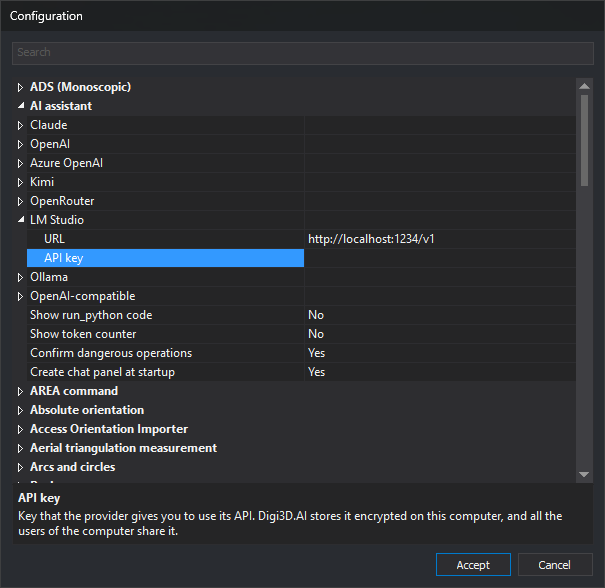

# AI assistant
<!-- id: configuracion-del-asistente-de-ia -->
<!-- origen: 32f852a3606b62ab1c8f654808e57ef9e018e1c8 -->

Configures the [AI chat pane](../../../asistente-ia/README.md): the address and API key of each provider, and four pane behavior options.

Configure these options in the **[Configuration](../README.md)** dialog. The **⚙** button in the chat pane header opens that dialog with this category selected.

## Options

* **[URL](url-del-proveedor-de-ia.md)** — Base address of a provider API.
* **[API key](clave-de-api-del-proveedor-de-ia.md)** — Key supplied by the provider for using its API.
* **[Show run_python code](mostrar-codigo-run-python.md)** — Displays the Python code run by the assistant and its output in the chat.
* **[Show token counter](mostrar-contador-de-tokens.md)** — Displays conversation token counts in the pane header.
* **[Confirm dangerous operations](confirmar-operaciones-peligrosas.md)** — Requests confirmation before deleting geometries, writing or deleting files, or accessing the network.
* **[Create chat panel at startup](crear-panel-de-chat-al-iniciar.md)** — Creates the chat pane when Digi3D.AI starts.

The category contains an item for each provider. Each item groups that provider **URL** and **API key** options.

## Providers

| Provider | Default URL | Requires API key |
| :--- | :--- | :--- |
| Claude | `https://api.anthropic.com/v1` | Yes |
| OpenAI | `https://api.openai.com/v1` | Yes |
| Azure OpenAI | None: must be entered | Yes |
| Kimi | `https://api.moonshot.ai/v1` | Yes |
| OpenRouter | `https://openrouter.ai/api/v1` | Yes |
| LM Studio | `http://localhost:1234/v1` | No |
| Ollama | `http://localhost:11434/v1` | No |
| OpenAI-compatible | None: must be entered | No |

## Provider and model

This category does not contain the active provider or model. Select them in the **Provider** and **Model** drop-down lists in the chat pane header.

## Applying changes

Changes are saved when you click **Accept** in the Configuration dialog. On acceptance, the chat pane reads the options again. If the active provider URL or API key changes, the pane recreates the assistant, which forgets the current conversation, although the messages remain on screen.

Instructions for obtaining each provider key are in [Cloud providers](../../../asistente-ia/proveedores.md).
