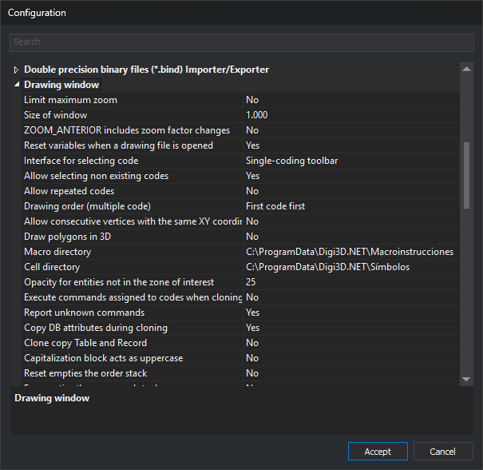

# Drawing window
<!-- id: diging -->
<!-- origen: 515ebc6d3bd50112d5b8f1cefa07138e51bb9135 -->

Groups drawing window options: zoom, code selection, commands, cloning, macroinstruction and symbol directories, and the **Coordinate Reference System** field of the **New project** dialog.

Configure these options in the **[Configuration](../README.md)** dialog.
