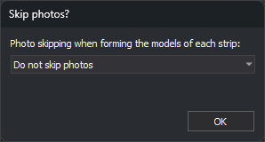

# Ask for photo skipping
<!-- id: solicitar-salto-de-fotos -->
<!-- origen: d1a614b608651bbdd1fb8dee501df64110b0854d -->

If enabled, opening an Inpho project (`.prj` file) makes Digi3D.AI display the **Skip photos?** dialog, where you can choose how stereo models are formed for each strip.

## Possible values

* **Yes**. The **Skip photos?** dialog appears whenever an Inpho project opens.
* **No**. The dialog does not appear, and each model is formed from two consecutive photos in the strip. This is the default value.

## Skip photos? dialog



The drop-down list specifies how models are formed in each strip. Photos in a strip are traversed in the order in which they appear in the project file. In the table, *n* is the **Photos to skip** value and photos are numbered 1, 2, 3… within the strip:

| Option | Models formed | Example with *n* = 1 |
|---|---|---|
| **Do not skip photos** | Each photo that has a following photo in the strip forms a model with that following photo. | 1-2, 2-3, 3-4… |
| **Skip photos** | Each model is formed from a photo and the one *n* + 1 positions after it in the strip. Each model after the first starts at the right photo of the previous model, so intermediate photos are not part of any model. | 1-3, 3-5, 5-7… |
| **Skip photos but use them for another model** | Each model is formed from a photo and the one *n* + 1 positions after it in the strip. A model starts at each photo in the strip that has another photo *n* + 1 positions after it. | 1-3, 2-4, 3-5… |

Each model name consists of its left and right photo names separated by a hyphen.

### Photos to skip

Specifies the number of photos between the left and right photos of each model. The Photos to skip field is only displayed if an option other than **Do not skip photos** is selected. The field accepts from 0 to 1000 photos, inclusive; with 0 photos, all three options form the same models.

### OK

Loads the project with models formed according to the selected option. Pressing **Esc** closes the dialog and loads the project without skipping photos.

> **See also:** [Omit models for which no photo is available](omitir-modelos-para-los-cuales-no-hay-foto.md), which applies after models are formed.

<details>
<summary>Where it is stored</summary>

| File | [Digi3DNET.db](../../../archivos/archivo-de-configuracion-digi3dnet.db.md) |
| :--- | :--- |
| Folder | `Digi3D\Extensiones\Digi3D.ConicSensor\Inpho` |
| Table | `Ints` |
| Value | `MostrarDialogoSaltoFotos` |
| Default value | 0 |

These SQL statements set the value 1, whether or not the row exists. Run them in the [Advanced configuration](../../configuracion-avanzada.md) dialog and restart Digi3D.AI:

```sql
INSERT OR IGNORE INTO Keys (Path) VALUES ('Digi3D\Extensiones\Digi3D.ConicSensor\Inpho');
DELETE FROM Ints WHERE Value = 'MostrarDialogoSaltoFotos' AND Key = (SELECT Id FROM Keys WHERE Path = 'Digi3D\Extensiones\Digi3D.ConicSensor\Inpho');
INSERT INTO Ints (Key, Value, Data) SELECT Id, 'MostrarDialogoSaltoFotos', 1 FROM Keys WHERE Path = 'Digi3D\Extensiones\Digi3D.ConicSensor\Inpho';
```

</details>
