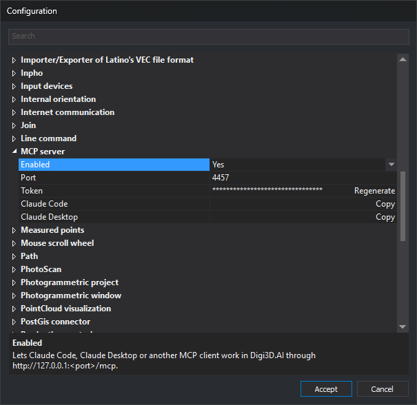

# MCP server
<!-- id: configuracion-del-servidor-mcp -->
<!-- origen: a1a7b97c442eba270e4b7eb5c6d737e779517182 -->

Configures the [MCP server](../../../asistente-ia/servidor-mcp.md), which allows Claude Code, Claude Desktop, or another MCP client to work in Digi3D.AI.

Configure these options in the **[Configuration](../README.md)** dialog.

## Options

* **[Enabled](activar-servidor-mcp.md)** — Enables the MCP server.
* **[Port](puerto-del-servidor-mcp.md)** — TCP port on which the server listens.
* **[Token](token-del-servidor-mcp.md)** — Key sent by clients to connect to the MCP server. The **Regenerate** button creates a new token.
* **[Claude Code](conectar-claude-code.md)** — The **Copy** button copies the command that connects Claude Code to the clipboard.
* **[Claude Desktop](conectar-claude-desktop.md)** — The **Copy** button copies the configuration that connects Claude Desktop to the clipboard.

## Applying changes

Changes are saved when you click **Accept** in the Configuration dialog. If you changed **Enabled**, **Port**, or **Token**, Digi3D.AI saves all three values and restarts the server. If none of the three changed, the server keeps running without restarting.

The **Regenerate** and **Copy** buttons also save the **Enabled**, **Port**, and **Token** values displayed in the dialog and restart the server if any of those three values changed. The copied command and configuration allow connection to the server even if you click **Cancel** after copying the command or configuration with Copy.

The [Confirm dangerous operations](../asistente-de-ia/confirmar-operaciones-peligrosas.md) option in the AI assistant category also affects MCP clients.
