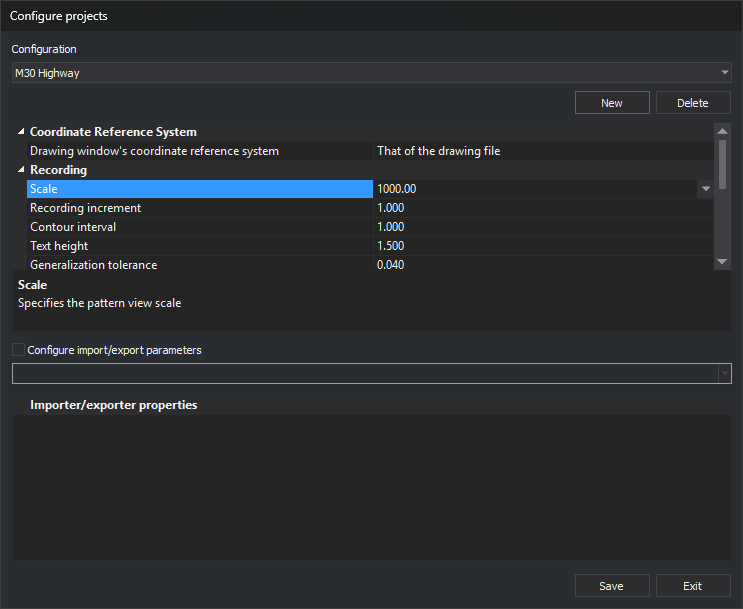
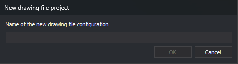

# Configure projects
<!-- id: configurar-proyectos -->
<!-- origen: 6dba2ede27f88828056fa8fd45032617a18ca7a5 -->



This dialog creates, modifies, and deletes project configurations. A project configuration groups the parameters used to open a drawing file: coordinate reference system, registration parameters, code table, keyboard, and, optionally, importer/exporter parameters.

Configurations are used on the [Drawing file](nuevo-proyecto/archivo-de-dibujo.md) tab of New project when [Use project files](configuracion/comunicacion-con-el-usuario/utilizar-archivos-de-proyecto.md) is enabled in [Configuration](configuracion/README.md). In that case, the user only selects the configuration, and New project applies its parameters to the drawing file.

## Opening the dialog

Select **Tools/Configure projects...** from the menu. This option is only enabled when **Use project files** is enabled.

## Fields

* **Configuration**: configuration being edited.
* **New**: opens **New drawing file project**, which requests the new configuration name and adds it to the list. If a configuration with that name already exists, a notification appears and it is not added. The new configuration is not saved until you click **Save**.

  
* **Delete**: immediately deletes the selected configuration, without clicking **Save**.
* Configuration **property grid**:
  * **Coordinate Reference System**: drawing window coordinate reference system.
  * **Registry**: **Scale**, **Registry increase**, **Equidistance**, **Text height**, **Tolerance to be generalized**, **Z correction**, and **Sigma**. These are the same parameters as on the [Drawing file](nuevo-proyecto/archivo-de-dibujo.md) tab. **Scale** accepts any value and offers a list of scales from 100 to 250000.
  * **Environment**: **Code table**, **Macro directory**, **Keyboard** (key assignment file), **Cell directory**, and **Startup command**. **Startup command** is the command run whenever a drawing file opens; to run a macroinstruction file, enter `@` followed by its path. If **Macro directory** or **Cell directory** is empty, Digi3D.AI uses the directories from **Configuration**.
* **Configure import/export parameters**: if checked, the configuration includes importer/exporter parameters. Select a format in the lower list to edit its properties in **Importer/exporter properties**. When opening a drawing file with this configuration, these parameters are used and New project does not display the import/export engine category.
* **Save**: saves the selected configuration.
* **Exit**: closes the dialog. Unsaved changes are lost.

## Notes

* If Digi3D.AI is not running as administrator, **Save** and **Delete** display the _Windows_ elevation shield icon. Clicking them does not request elevation: they save or delete the configuration anyway.
* Configurations are shared by all computer users: they are saved in the [Digi3DNET.db configuration file](../archivos/archivo-de-configuracion-digi3dnet.db.md).

<details>
<summary>Where it is stored</summary>

Each configuration is saved in a folder in the Digi3DNET.db configuration file:

| File | [Digi3DNET.db](../archivos/archivo-de-configuracion-digi3dnet.db.md) |
| :--- | :--- |
| Folder | `DigiNG\Configuration\Projects\<proyecto>\` |
| Tables | `Ints`, `Texts`, and `Doubles` |

`<proyecto>` is the configuration name. The path ends in `\`. Digi3D.AI enumerates configurations by searching the `Keys` table for paths starting with `DigiNG\Configuration\Projects\`. **Delete** removes the configuration folder, its subfolders, and all its values.

Importer/exporter parameters are saved in the `DigiNG\IO\<formato>` subfolder of the configuration folder, for example `DigiNG\Configuration\Projects\<proyecto>\DigiNG\IO\Digi21.Io.Dgn`. Digi3D.AI only uses them if `ConfigurarParametrosIO` is 1 in the configuration.

These SQL statements set scale 5000 for `Cartografia`, whether or not the row exists. Run them in [Advanced configuration](configuracion-avanzada.md):

```sql
INSERT OR IGNORE INTO Keys (Path) VALUES ('DigiNG\Configuration\Projects\Cartografia\');
DELETE FROM Doubles WHERE Value = 'Escala' AND Key = (SELECT Id FROM Keys WHERE Path = 'DigiNG\Configuration\Projects\Cartografia\');
INSERT INTO Doubles (Key, Value, Data) SELECT Id, 'Escala', 5000.0 FROM Keys WHERE Path = 'DigiNG\Configuration\Projects\Cartografia\';
```

### Configuration values

Folder `DigiNG\Configuration\Projects\<proyecto>\`.

| Value | Table | Default | What it does | Field |
| :--- | :--- | :--- | :--- | :--- |
| `AlturaTextos` | `Doubles` | 1.5 | Specifies the height of registered texts (TH variable) | Registry › Text height |
| `ArchivoInicio` | `Texts` | (empty) | Command run whenever a drawing file opens, including from the command line, after code table startup commands and before the command specified on the command line. To run a macroinstruction file, enter @ followed by its path. | Environment › Startup command |
| `ArchivoTeclasMenu` | `Texts` | (empty) | Specifies the path of the keyboard configuration file. | Environment › Keyboard |
| `ConfigurarParametrosIO` | `Ints` | 0 | If 1, the project saves import and export parameters for each format, and Digi3D.AI does not request them when opening files. | **Configure import/export parameters** |
| `CorreccionZ` | `Doubles` | 0.0 | Specifies the Z difference between operators (adjust if the person performing absolute orientation differs from the person plotting the model) | Registry › Z correction |
| `DigiTab` | `Texts` | (empty) | File containing code information, including representation and translation. | Environment › Code table |
| `DirectorioCelulas` | `Texts` | (empty) | Specifies the directory containing cell definitions. | Environment › Cell directory |
| `DirectorioTablas` | `Texts` | (empty) | Specifies the directory containing macroinstruction files. | Environment › Macro directory |
| `Equidistancia` | `Doubles` | 1.0 | Specifies the interval in meters at which contour lines are registered. | Registry › Equidistance |
| `Escala` | `Doubles` | 1000.0 | Project working scale. | Registry › Scale |
| `IncrementoRegistro` | `Doubles` | 1.0 | Specifies the interval in meters at which points are registered in continuous mode. | Registry › Registry increase |
| `Sigma` | `Doubles` | 0.001 | Specifies the value below which two values are considered identical. | Registry › Sigma |
| `ToleranciaGeneralizar` | `Doubles` | 0.04 | Specifies the minimum segment length when registering in continuous mode. | Registry › Tolerance to be generalized |
| `WktVentanaDibujov2` | `Texts` | compound local CRS | Drawing window coordinate reference system, in WKT. | Coordinate Reference System |

### Importer/exporter parameters

Folder `DigiNG\Configuration\Projects\<proyecto>\DigiNG\IO\<formato>`. Edited in **Importer/exporter properties**.

#### `Digi21.Io.AsciiDigi`

| Value | Table | Default | What it does | Field |
| :--- | :--- | :--- | :--- | :--- |
| `NumeroDecimales` | `Ints` | 3 | Specifies the number of decimal places used when exporting a file to Digi ASCII format. | Decimals |
| `WktSistemaCoordenadas3D` | `Texts` | compound local CRS | File coordinate reference system, in WKT. | — |

#### `Digi21.Io.Bin`

| Value | Table | Default | What it does | Field |
| :--- | :--- | :--- | :--- | :--- |
| `NPrecision` | `Ints` | 2 | Specifies the number of decimal places used when saving/retrieving entities in this file. | Accuracy decimals |
| `X` | `Doubles` | 0.0 | Specifies the X coordinate used as the global model origin. | X |
| `Y` | `Doubles` | 0.0 | Specifies the Y coordinate used as the global model origin. | Y |
| `Z` | `Doubles` | 0.0 | Specifies the Z coordinate used as the global model origin. | Z |

#### `Digi21.Io.BinDouble`

| Value | Table | Default | What it does | Field |
| :--- | :--- | :--- | :--- | :--- |
| `BaseDatosSoloLectura` | `Ints` | 0 | When connected in read-only mode, database records are neither created nor modified. | Connect in read-only mode |
| `CadenaConexion` | `Texts` | (empty) | Specifies the connection string for connecting to the database that stores information for entities in this file. | Connection string |
| `GestorModeloDatosBaseDatos` | `Texts` | `Sin conexión con base de datos` | Selects the Database Data Model Manager used to store data in the database. | Data model |
| `OmitirCargaArchivosReferencia` | `Ints` | 0 | If enabled, reference files associated with the file are not loaded. | Skip loading reference files |

#### `Digi21.Io.Csv`

| Value | Table | Default | What it does | Field |
| :--- | :--- | :--- | :--- | :--- |
| `NombreColumnaX` | `Texts` | (empty) | Specifies the name of the column containing the X coordinate. | Column X |
| `NombreColumnaY` | `Texts` | (empty) | Specifies the name of the column containing the Y coordinate. | Column Y |
| `NombreColumnaZ` | `Texts` | (empty) | Specifies the name of the column containing the Z coordinate. | Column Z |
| `Separador` | `Texts` | `tabulador` | Column separator character. The first character is used. | — |

#### `Digi21.Io.Dgn`

| Value | Table | Default | What it does | Field |
| :--- | :--- | :--- | :--- | :--- |
| `ArchivoCelulas` | `Texts` | (empty) | Specifies the cell file associated with the DGN file. | Cell file |
| `ArchivoPlantilla` | `Texts` | (empty) | Specifies the path of a template file used as a base when creating new drawing files. This parameter is optional. If omitted, a file is created based on the active code table. | Template file |
| `CriterioCodigos` | `Ints` | 0 | Specifies the code selection criterion. | Code criteria |
| `FormatoDesconocidos` | `Texts` | `$(Nivel)` | Specifies the code format used to import entities with no association in the translation table. The following replacers can be used: $(Nivel) $(Color) $(Estilo) $(Grosor) $(GrupoGrafico) | Unknown format |
| `ImportarCelulasComoPuntual` | `Ints` | 1 | Specifies the entity type into which DGN file cells are transformed. | Import cells as |
| `ImportarPaletaDGN` | `Ints` | 1 | Specifies whether to import the DGN file color palette (only if the DGN file has a palette to import). | Import palette |
| `IncrementoRegistroSplines` | `Doubles` | 1.0 | Specifies the registration increment used when converting splines to polylines while importing drawing files containing splines. | Registry spline increase |
| `RutasArchivosRecursos` | `Texts` | (empty) | Enter MicroStation resource file paths here, separated by semicolons. The last file has the highest priority. | Symbology resource files |
| `TransformarNivelesEntidadesQueFormanCell` | `Ints` | 0 | If enabled, levels of entities forming part of a cell are transformed when exporting to DGN format. | Transform the cell entity level |
| `UtilizarArchivoCelulas` | `Ints` | 0 | Specifies whether Digi3D.AI obtains cell shapes from the Digi symbol folder or from a supplied .cel file. | Extract cells from |
| `UtilizarColoresDGN` | `Ints` | 1 | Specifies whether entities are displayed with colors defined in the DGN file or colors defined in the active code table. | Entity colors |

#### `Digi21.Io.Dwg`

| Value | Table | Default | What it does | Field |
| :--- | :--- | :--- | :--- | :--- |
| `ImportarBloques` | `Ints` | 0 | Specifies whether to import blocks from the DWG file, generating .bin files in the specified directory. | Import blocks |
| `ImportarBloquesComoPuntual` | `Ints` | 1 | Specifies the entity type into which DWG/DXF file blocks are transformed. | Import blocks as |
| `ImportarPaleta` | `Ints` | 0 | Specifies whether to import the color palette stored in the drawing file. | Import palette |
| `RutaArchivoPlantilla` | `Texts` | (empty) | Specifies the path of a template file used as a base when creating new drawing files. This parameter is optional. If omitted, a file is created based on the active code table. | Template file |
| `RutaImportacionBloques` | `Texts` | (empty) | Specifies the directory in which blocks found in the DWG file are saved (if block import is enabled). | Import route |
| `UtilizarColoresArchivoDibujo` | `Ints` | 0 | If enabled, entities with an individual color in the drawing file import that color. Otherwise, entity color is always by layer. | Use drawing file colors |
| `Version` | `Ints` | 3 | Specifies the file version to generate. | Version |

#### `Digi21.Io.Dxf`

| Value | Table | Default | What it does | Field |
| :--- | :--- | :--- | :--- | :--- |
| `Binario` | `Ints` | 0 | Specifies whether to create a binary or ASCII DXF file. | File type |
| `ImportarBloques` | `Ints` | current parameter value | If 1, imports DXF file blocks as .bin files. | — |
| `ImportarBloquesComoPuntual` | `Ints` | current parameter value | Entity type into which DXF file blocks are transformed. | — |
| `ImportarPaleta` | `Ints` | current parameter value | If 1, imports the DXF file color palette. | — |
| `RutaArchivoPlantilla` | `Texts` | current parameter value | Template file for creating new DXF files. | — |
| `RutaImportacionBloques` | `Texts` | current parameter value | Folder where imported blocks are saved. | — |
| `UtilizarColoresArchivoDibujo` | `Ints` | current parameter value | If 1, entities with an individual color in the DXF retain that color. | — |
| `Version` | `Ints` | current parameter value | DXF file version to generate. | — |

#### `Digi21.Io.GeoJson`

| Value | Table | Default | What it does | Field |
| :--- | :--- | :--- | :--- | :--- |
| `WktSistemaCoordenadas3D` | `Texts` | compound local CRS | File coordinate reference system, in WKT. | — |

#### `Digi21.Io.Geomedia`

| Value | Table | Default | What it does | Field |
| :--- | :--- | :--- | :--- | :--- |
| `WktSistemaCoordenadas3D` | `Texts` | compound local CRS | File coordinate reference system, in WKT. | — |

#### `Digi21.Io.Kml`

| Value | Table | Default | What it does | Field |
| :--- | :--- | :--- | :--- | :--- |
| `Descripcion` | `Texts` | (empty) | Specifies a description displayed below the title in Google Earth. | Description |
| `Titulo` | `Texts` | (empty) | Specifies the title of the created place. | Title |

#### `Digi21.Io.Orthophoto`

| Value | Table | Default | What it does | Field |
| :--- | :--- | :--- | :--- | :--- |
| `Comprimir` | `Ints` | 1 | If enabled, the image is compressed in graphics card memory. Compression allows more images to fit in graphics card memory than without compression. | Compress |
| `NivelPiramidalCargar` | `Ints` | 0 | Specifies the pyramid level to load. If the image lacks that pyramid level, the nearest available one is loaded. | Pyramidal level |

#### `Digi21.Io.Pdf`

| Value | Table | Default | What it does | Field |
| :--- | :--- | :--- | :--- | :--- |
| `ExplotarSimbologia` | `Ints` | 1 | If enabled, lines are displayed with their symbology. | Use symbology |
| `Tamano` | `Ints` | 0 | PDF paper size. | Paper size |
| `Titulo` | `Texts` | (empty) | Specifies the document title. | Title |

#### `Digi21.Io.PostGIS`

| Value | Table | Default | What it does | Field |
| :--- | :--- | :--- | :--- | :--- |
| `BaseDatos` | `Texts` | (empty) | Specifies the database to connect to among those available on the server. | Database |
| `Condiciones` | `Texts` | (empty) | Additional SQL conditions for filtering loaded geometries. | — |
| `Contraseña` | `Texts` | (empty) | Specifies the server connection password. | Password |
| `Puerto` | `Ints` | 5432 | Specifies the server connection port. | Port |
| `Servidor` | `Texts` | `localhost` | Specifies the database server name (or address) on the network. | Server |
| `Usuario` | `Texts` | (empty) | Specifies the username for connecting to the server. | User |

#### `Digi21.Io.Shp`

| Value | Table | Default | What it does | Field |
| :--- | :--- | :--- | :--- | :--- |
| `CargarRegionDeInteres` | `Ints` | 0 | If enabled, loads only the region of interest. To define the region of interest, right-click the file in the drawing file pane. | Load region of interest (BETA) |
| `ldid` | `Ints` | 255 | Specifies the encoding used to store text strings in the created database. | Encoding |
| `precision` | `Ints` | 0 | Specifies the number of decimal places for export, from 0 to 12. Set 0 if no precision rounding is required. | Precision decimals |

#### `Digi21.Io.Svg`

| Value | Table | Default | What it does | Field |
| :--- | :--- | :--- | :--- | :--- |
| `ancho` | `Ints` | 400 | Specifies drawing width in pixels. Height is calculated from width. | Drawing width |

#### `Digi21.Io.Wkt`

| Value | Table | Default | What it does | Field |
| :--- | :--- | :--- | :--- | :--- |
| `ancho` | `Ints` | 400 | Drawing width in pixels. | — |

</details>
