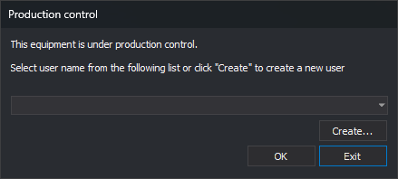
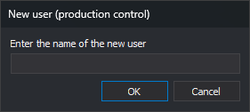

# Production control
<!-- id: cuadro-control-de-produccion -->
<!-- origen: 3ae53b57b73d0a703175bda26fb924d05b129446 -->

This dialog requests the name of the user who will work on the computer. Digi3D.AI displays it at startup if [Production control](configuracion/control-de-produccion/controlar-produccion.md) is enabled in [Configuration](configuracion/README.md) and Digi3D.AI is run without command line arguments.

## Fields

* **User list**: users created under your Windows account, in alphabetical order. Select your username.
* **Create...**: opens **New user (production control)**, which requests the new username. Digi3D.AI trims leading and trailing spaces; if the result is empty, it beeps and leaves the dialog open. The new user is added and selected. If a user with that name already exists (ignoring case), it is neither added nor selected.

  
* **OK**: starts Digi3D.AI with the selected user. Does nothing if none is selected.
* **Exit**: closes Digi3D.AI. Esc has the same effect.

## Notes

* While Digi3D.AI is open, the production bar in the status bar shows user activity. See [Display time](configuracion/control-de-produccion/tiempo-de-visualizacion.md).
* Digi3D.AI saves activity every minute in one encrypted file per user and day in **C:\ProgramData\digi21.net**. The filename is the UTC startup date followed by the username, for example **20261004-Juan**. Reopening Digi3D.AI on the same day with the same user continues the bar from the saved activity.
