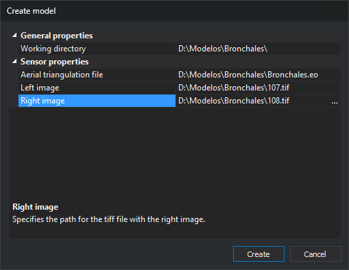

# Create model
<!-- id: crear-modelo -->
<!-- origen: d7130238280502a342d73e03d6ac663cba98e2d5 -->

This dialog creates a model file (`.d3d`) and adds it to the selected strip. It is opened by **Create** in the **Models** list of [Create photogrammetric project](crear-proyecto-fotogrametrico.md).

## Fields

* **Overall properties**
  * **Work directory**: folder where the model file is created. Default: project file folder.
  * **.d3d file name**: name, without extension, of the model file. Digi3D.AI proposes the model name formed by the sensor (with Conical, the left and right image names separated by a hyphen) and recalculates it whenever you change a dialog property, unless you have typed a different name in this field.
* **Sensor properties**: parameters of the sensor selected under **Sensor** in Create photogrammetric project. Each sensor shows its own parameters. For example, Conical requests the aerial triangulation file and left and right images.
* **Description area**: the lower area describes the selected parameter.
* **Create**: creates the model file in the working directory, using the value of the **.d3d file name** field and the `.d3d` extension (for example, **107-108.d3d** with Conical and the proposed name). Adds the model to **Models** and closes the dialog.
* **Cancel**: closes without creating the model.

## Notes

* Before creating the model file, Digi3D.AI checks the properties of the [Web Map Service](../ventana-fotogrametrica/sensores/wms.md), [Web Map Tile Service](../ventana-fotogrametrica/sensores/wmts.md) and 3D models sensors (for example, the server URL): if a property is invalid, Digi3D.AI displays a message and the dialog remains open. With the other sensors, **Create** accepts sensor parameters as they are.
* Before creating the file, Digi3D.AI removes leading and trailing spaces from **.d3d file name** and a typed `.d3d` extension. If the resulting name is empty, ends with a period or a space, contains control characters or any of the characters `\ / : * ? " < > |`, or is a reserved Windows name (`CON`, `PRN`, `AUX`, `NUL`, `COM1` to `COM9` and `LPT1` to `LPT9`, with or without extension), Digi3D.AI displays a message, selects the field and the dialog remains open.
* If the `.d3d` file already exists in the working directory, **Create** asks “Do you want to save the new model in the existing model file?”. **No** leaves the dialog open with **.d3d file name** selected. **Yes** updates the file's working directory, sensor and parameters, preserving the rest of its contents.
* If the file cannot be written, Digi3D.AI displays “Unable to create photogrammetric model”, with the file path and failure description. The model is still added to **Models**.
* **Create** does not check whether the model is already in **Models**. If it is, it appears twice.
