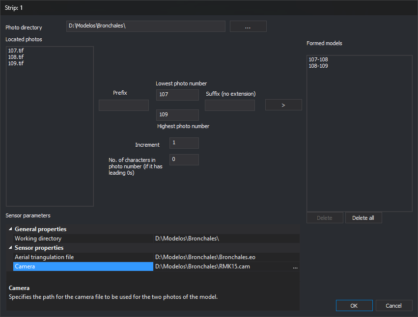

# Create multiple models
<!-- id: crear-multiples-modelos -->
<!-- origen: 5d79fafd6f84a3936b01979271313dc8e439c74e -->

This dialog creates a strip's model files (`.d3d`) together from photo numbers and adds them to the selected strip. It is opened by **Create Various** in **Models** in [Create photogrammetric project](crear-proyecto-fotogrametrico.md). That button is only enabled for Conical. The dialog title is the strip name.

Each model uses two photos whose numbers differ by **Increase**. For example, photos 107, 108 and 109 with an increment of 1 produce **107-108** and **108-109**.

## Fields

* **Directory containing photos**: photo folder. **...** selects it.
* **Located photos**: images in the folder, in any raster format supported by Digi3D.AI.
* **Prefix**: text preceding the number in photo names.
* **Lowest photo number** and **Highest photo number**: range of photo numbers from which models are formed.
* **Postfix (without extension)**: text following the photo number, without the file extension.
* **Increase**: difference between the two photo numbers in a model. A negative value forms models from the highest photo towards the lowest. With 0, no models are formed.
* **No. of characters in photo number (if it has leading 0s)**: number of digits in the photo number, padded with leading zeros. For example, 4 looks for photo 25 as **0025**. With 0, the number has no padding.
* **>**: forms models and adds them to **Formed models**. For each photo number in the range, searches case-insensitively for the left and right photos named *prefix + number + postfix*. Adds the model only if both photos are found and it is not already listed. Enabled if **Located photos** contains at least one image and the highest photo number exceeds the lowest.
* **Formed models**: models to create, named *left photo-right photo*.
* **Delete** and **Delete All**: remove the selected model or all models from the list.
* **Sensor parameters**: **Work directory**, where model files are created, and parameters shared by all models of the selected sensor (for example, the aerial triangulation file and camera with Conical).
* **OK**: creates one *left photo-right photo*.d3d file per model in **Formed models** in the working directory, adds them to the strip and closes. Existing `.d3d` files are overwritten without warning. If a file cannot be created, displays “Error when creating file: *path*” and continues. On completion, displays “Located errors when generating the following files:” with the failed files and leaves the dialog open. Successfully created files remain on disk.
* **Cancel**: closes without creating models.

## Notes

Digi3D.AI remembers prefix, postfix, photo numbers, increment and character count for the next time the dialog opens.
