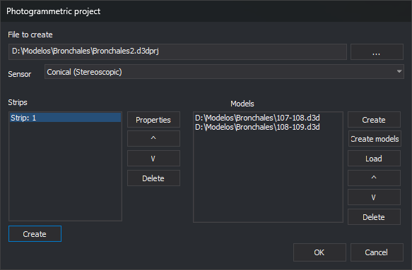
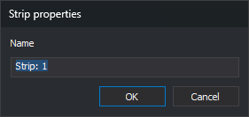

# Create photogrammetric project
<!-- id: crear-proyecto-fotogrametrico -->
<!-- origen: 4d23aab9979d17f1296fb09db3205eb1e82441d3 -->

This dialog creates or edits a photogrammetric project file (`.d3dprj`). The file lists project strips and the models (`.d3d` files) in each strip. The [Photogrammetric project](../paneles/proyecto-fotogrametrico.md) pane loads it for fast model switching.

## Opening the dialog

Click the new project button on the [Photogrammetric project](../paneles/proyecto-fotogrametrico.md) pane toolbar.

The dialog requires the photogrammetry license module. If the computer's license does not include the photogrammetry module, Digi3D.AI displays a message and does not open the dialog.

## Fields

* **File project**: project file path. **...** selects it. While empty, **Sensor**, strip and model buttons, and **OK** are disabled.

  If the file exists, its strips and models are loaded for editing. If it is not valid XML, the dialog shows “Error on line: *n*, column: *n*” with the cause, and controls remain disabled.
* **Sensor**: sensor for models created with **Create** and **Create Various**. Only sensors that can create projects are listed: **Conical (Stereoscopic)** and **RPC Satellite (stereoscopic)** (RPC: rational polynomial coefficients). See [Projects with multiple pairs](../ventana-fotogrametrica/sensores/rpc/README.md#projects-with-multiple-pairs) for RPC Satellite projects. Initially the sensor selected the last time **OK** was clicked is selected automatically.
* **Strips**: project strips.
  * **Create**: opens [Strip properties](#strip-properties) and adds a strip.
  * **Properties**: changes the selected strip's name. Also opened by double-clicking the strip.
  * **^** and **V**: move the selected strip up or down.
  * **Delete**: deletes the selected strip.
* **Models**: models in the selected strip. These buttons, the strip buttons and **OK** are only enabled if a strip is selected.
  * **Create**: creates a model with [Create model](crear-modelo.md).
  * **Create Various**: creates several models from photo numbers with [Create multiple models](crear-multiples-modelos.md). Only enabled if supported by the sensor. Models already in the list are not added again.
  * **Load**: adds an existing model file (`.d3d`).
  * **^** and **V**: move the selected model up or down.
  * **Delete**: removes the selected model from the strip without deleting its file.
* **OK**: saves the project file. If there are no strips, displays “There is no data to be saved. Create a strip and add models.” and does not save.
* **Cancel**: closes without saving.

## Strip properties

* **Name**: strip name. A new strip defaults to **Strip:** followed by its number.

## Notes

If [Replace paths with placeholders](configuracion/rutas/sustituir-rutas-por-sustituidores.md) is enabled, model paths use `$(DirectorioTrabajo)` when models are in the project file folder.
