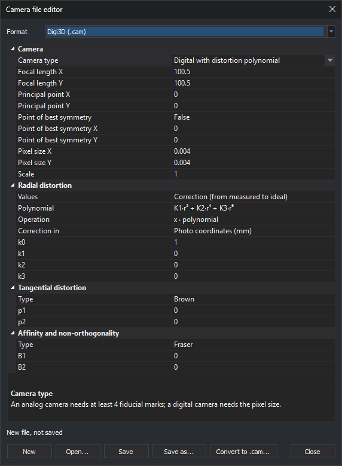

# Camera file editor
<!-- id: editor-archivos-camara -->
<!-- origen: 5c14afd795c1c93506e6fdc5627ba5c444c15671 -->

This dialog creates, opens and saves camera files in five formats read by the [conical sensor](../ventana-fotogrametrica/sensores/camara-conica/README.md). It also converts a camera from any other format or project, such as an Inpho project, to a Digi3D `.cam` file. No open model is required.

## Opening the dialog

Select **Tools/Camera file editor...**.

## Formats

Choose the file format under **Format**:

| Format | File | Page |
|---|---|---|
| Digi3D (.cam) | `.cam` with a `[Camara]` section | [Digi3D](../ventana-fotogrametrica/sensores/camara-conica/extensiones/digi3d.md) |
| RapidCal (.cal) | `.cal` | [RapidCal](../ventana-fotogrametrica/sensores/camara-conica/extensiones/rapidcal.md) |
| OpenCV (.cocv) | `.cocv` | [OpenCV](../ventana-fotogrametrica/sensores/camara-conica/extensiones/opencv.md) |
| Pix4D (.cam) | `.cam` whose name ends in `_pix4d_calibrated_internal_camera_parameters.cam` | [Pix4D](../ventana-fotogrametrica/sensores/camara-conica/extensiones/pix4d.md) |
| Agisoft PhotoScan and Metashape (.xml) | `.xml` containing a calibration (`calibration` root element) | [PhotoScan](../ventana-fotogrametrica/sensores/camara-conica/extensiones/photoscan.md) |

Changing formats clears the grid: the dialog does not convert between formats. To convert a camera to Digi3D `.cam`, use [Convert to .cam](#convert-to-cam).

## Properties

The grid shows the selected format's parameters. Selecting a property displays its description, units and file key below the grid.

Numbers accept a decimal point or comma. Non-numeric text restores the cell's previous value.

### Digi3D (.cam)

**Camera type** determines which properties appear:

* **Analog with distortion table**: requires at least four fiducial marks and has no pixel size.
* **Digital with distortion table**.
* **Digital with distortion polynomial**.

| Property | File key |
|---|---|
| **Focal length X**, **Focal length Y** | `Focal` (one value if both focal lengths are equal) |
| **Principal point X**, **Principal point Y** | `PuntoPrincipal` |
| **Point of best symmetry**, X and Y | `PPS`. If disabled, the key is omitted and distortion is centered on the principal point. |
| **Pixel size X**, **Pixel size Y** | `TamanoPixel` (one value if both are equal) |
| **Scale** | `Escala` |
| **Values** | `TipoValorDistorsion`: **Correction** (measured to ideal) or **Error** (ideal to measured) |
| **Polynomial** | `Pol` |
| **Operation** | `OperacionRadial` |
| **Correction in** | `TipoCorreccion`: **Photo coordinates** (`FotoAFiducial`) or **Camera coordinates** (`CamaraAFoto`) |
| **k0** to **k3** | `k0` to `k3` |
| **Distortion table** | `Distorsion1`, `Distorsion2`... |
| **Type** (tangential distortion) | `TipoDistorsionTangencial` |
| **p1**, **p2** | `p1`, `p2` |
| **Type** (affinity and non-orthogonality) | `TipoDesortogonalidad` |
| **B1**, **B2** | `B1`, `b2` |
| **Coordinates** (fiducial marks) | `Fiducial1`, `Fiducial2`... |

Tables are written as semicolon-separated number pairs. Each distortion table pair contains a radius and its distortion in mm; each fiducial mark pair contains X and Y coordinates in mm. For example: `10 0.001; 20 0.002`. If a pair does not contain exactly two numbers, **Save** does not write the file and displays “The text ‘*pair*’ in ‘*property*’ is not two numbers separated by a space…”.

The dialog writes the section and keys in Spanish. It always writes `TipoValorDistorsion` and, for polynomial cameras, `TipoCorreccion`, even with default values.

### Agisoft PhotoScan and Metashape (.xml)

**Parameterization** chooses between two camera representations:

* **Metashape**: focal length `f`, affinity `b1` and non-orthogonality `b2`. `cx` and `cy` are principal point offsets from the image center.
* **Legacy PhotoScan**: focal lengths `fx` and `fy` and non-orthogonality `skew`. `cx` and `cy` are the principal point column and row.

Changing parameterization preserves `cx` and `cy`: correct them according to their new meaning.

## Buttons

* **New**: clears the selected format's grid.
* **Open...**: opens a file in one of the five formats. The extension determines the format; Pix4D `.cam` files are distinguished by their first line, `Pix4D camera calibration file`. If the file cannot be read, the message explains why and states that cameras from other formats or projects are converted to `.cam` with **Convert to .cam...**.
* **Save**: saves to the open file. For a new file, acts as **Save as...**.
* **Save as...**: saves to a new file. For Pix4D, appends `_pix4d_calibrated_internal_camera_parameters.cam` if absent, because the Pix4D extension only recognizes that filename suffix.
* **Convert to .cam...**: see [Convert to .cam](#convert-to-cam).
* **Close**: closes the dialog. Unsaved changes are lost.

The line above the buttons shows the file path or “New file, not saved”.

## Convert to .cam

**Convert to .cam...** creates a Digi3D `.cam` from a camera in any format read by the conical sensor: Inpho, LPS or ContextCapture projects, PhotoScan, Pix4D or RapidCal files, etc.

1. Click **Convert to .cam...**.
2. Select the camera or project file.
3. Select a photo taken with that camera. Digi3D.AI reads its pixel dimensions; the photo must be TIFF (including BigTIFF), JPEG, PNG or BMP. For projects, the extension finds the camera by the photo name, so the photo must appear in the project. For a project with several cameras, repeat with one photo per camera.
4. Read the result message. The camera appears in the grid as a new, unsaved `.cam`.
5. Click **Save as...** to save it.

Digi3D.AI fits a **Digital with distortion polynomial** camera reproducing source camera rays on a 40 × 30 grid of photo pixels, including edges. The fit calculates focal length, principal point, `k1` to `k3` coefficients (with `Pol=K1_R2_K2_R4`, `OperacionRadial=X_CORRECTION` and `TipoCorreccion=FotoAFiducial`), Brown tangential distortion (`p1`, `p2`) and Fraser affinity and non-orthogonality (`B1`, `b2`). It tests both `TipoValorDistorsion` values and retains the one with the smallest error.

The result message reports:

* **Root mean square error** and **Maximum error**: pixel distance between the source camera pixel and the `.cam` pixel for the same ray.
* **Values**: chosen `TipoValorDistorsion` value.
* **Pixel size**: Inpho, LPS, Summit, DVP, Pix4D, Vexcel, Intergraph and Digi3D cameras provide focal length in mm, from which pixel size is derived. PhotoScan, Metashape, ContextCapture, OpenCV and RapidCal do not: the grid's **Pixel size X** is used. If it is not the camera's size, enter the correct value and convert again. Pixel size changes only the scale of `.cam` lengths, not rays.
* If the source camera uses other axes, such as Metashape, the message warns that source project exterior orientations cannot be used with the `.cam`, because the `.cam` axes have X to the right and Y upwards in the photo.
* If the source camera defines its own pixel origin (Inpho with `$PIXEL_REFERENCE`, Metashape, OpenCV or ContextCapture) and [Pixel origin](configuracion/ventana-fotogrametrica/origen-del-pixel.md) is **Pixel center**, the message warns that Digi3D.AI shifts the `.cam` by half a pixel without shifting the source camera: they differ by 0.7 pixels. With **Top left corner of pixel**, they coincide.

Error is almost zero when the source camera uses the same model or its interior orientation is rotated 90°, 180° or 270° relative to the pixels. Residual error remains when:

* The source camera has terms absent from `.cam`. For example, `.cam` lacks Metashape's `k4` (r⁸) coefficient: with `k4` = −0.28, root mean square error is 0.05 px and corner error is 0.45 px.
* Interior orientation is rotated by a non-multiple of 90°: `.cam` has no rotation parameter. A rotation of 0.1° gives a root mean square error of about 7 px.

For an analog camera, interior orientation is that of the selected photo: the `.cam` only reproduces photos digitized in the same way.

Messages:

* “The size of the photo *photo* cannot be read. Choose a TIFF, JPEG, PNG or BMP photo.”
* “No camera extension recognizes the file *file* with the photo *photo*.”
* “The source camera does not give a valid ray at pixel (*column*, *row*), so a .cam file cannot be fitted to it.”
